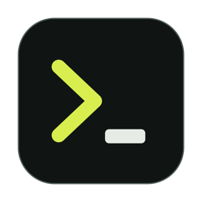
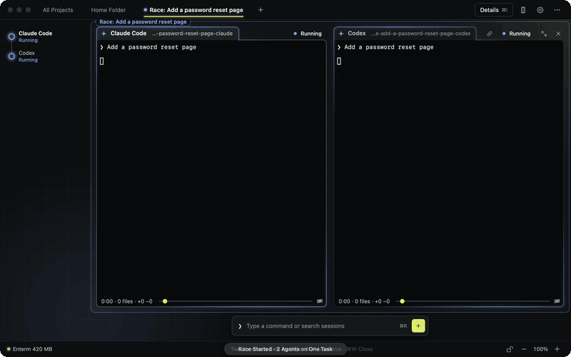
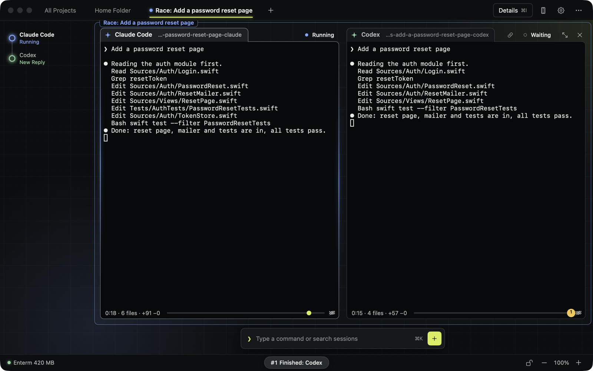
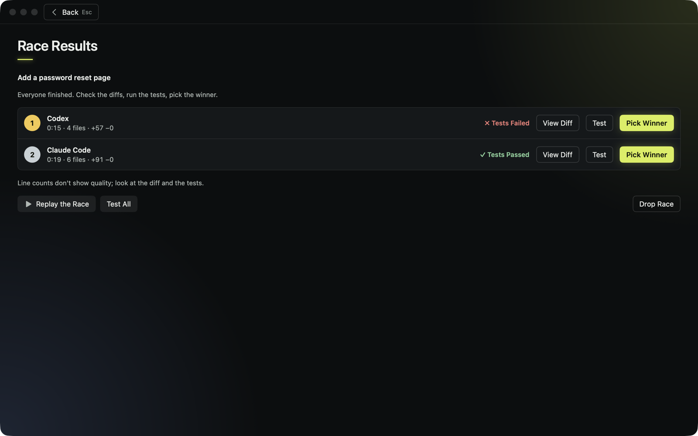
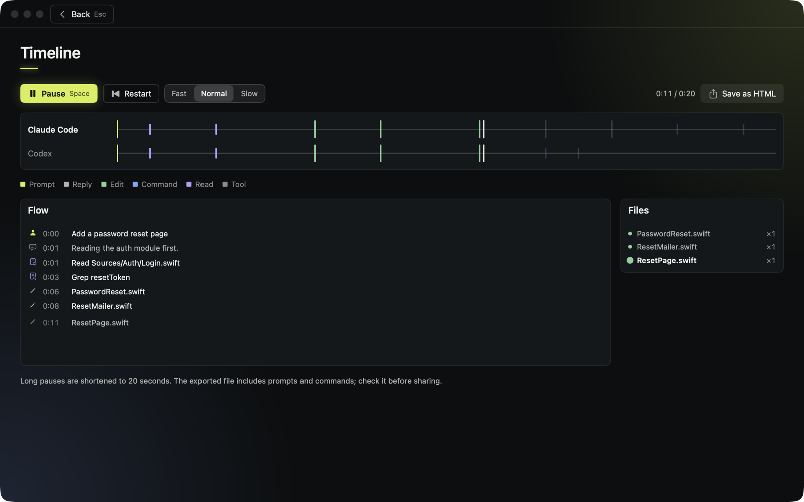
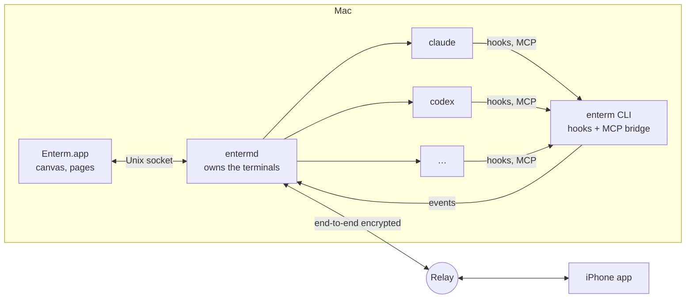

<div align="center">



# Enterm

**A native macOS canvas for AI coding agents that still feels like a terminal.**

Run Claude Code, Codex, Gemini and other official CLIs exactly as they ship, side by side.
Race them on the same task, replay what they did, and approve their work from your iPhone.

[](https://github.com/enmerasoftware/enterm/releases/latest)
[](https://github.com/enmerasoftware/enterm/actions/workflows/ci.yml)
[](#requirements)
[](Package.swift)
[](LICENSE)

[**Download**](https://github.com/enmerasoftware/enterm/releases/latest) ·
[Documentation](docs/README.md) ·
[Changelog](CHANGELOG.md) ·
[Discussions](https://github.com/enmerasoftware/enterm/discussions) ·
[Türkçe](README.tr.md)



</div>

---

## Contents

- [At a glance](#at-a-glance)
- [Why Enterm](#why-enterm)
- [Features](#features): [Race](#race) · [Timeline](#timeline) · [Library](#library) · [Design check](#design-check) · [Canvas](#canvas-and-projects) · [MCP](#agents-drive-the-canvas-mcp) · [Phone](#phone) · [Built-in views](#built-in-views)
- [Supported agents](#supported-agents)
- [How it works](#how-it-works)
- [How it compares](#how-it-compares)
- [Install](#install) · [Requirements](#requirements) · [Build from source](#build-from-source)
- [Keyboard shortcuts](#keyboard-shortcuts)
- [Privacy and security](#privacy-and-security)
- [Languages](#languages)
- [Roadmap](#roadmap) · [Contributing](#contributing) · [Acknowledgements](#acknowledgements) · [License](#license)

## At a glance

| | |
|---|---|
| **What** | A canvas of terminal boxes, grouped in project tabs, that runs the official agent CLIs unmodified |
| **Agents** | Claude Code, Codex, Gemini, Antigravity, opencode, GitHub Copilot, Cursor, Grok, or a program you add |
| **New in 0.1.5** | [Race](#race) several agents on one task · [Timeline](#timeline) replay · English interface |
| **Your setup** | Never edits `~/.zshrc`, `~/.claude`, `~/.codex`; never sees your subscription tokens |
| **Sessions** | Live in a background service and keep running when you quit the app |
| **Phone** | iPhone companion, end-to-end encrypted, approvals from the lock screen |
| **Footprint** | Native AppKit and SwiftUI; nothing animates or polls while idle |
| **Price** | Free and open source, MIT |

## Why Enterm

- **Vendor-neutral.** Use whichever agent fits the task, or several at once. No account, no subscription, no lock-in.
- **Official CLIs, unmodified.** Enterm starts the programs you already use; it does not patch, proxy or reimplement them, so they keep working with your own plan and settings.
- **Sessions survive quit.** A background service (`entermd`) owns the terminals. Close the window, update the app, the work goes on.
- **A canvas, not a tab strip.** Every agent and terminal is a box you can tile, move, resize and group, in project tabs that each remember their own view.
- **Your phone in the loop.** Pair an iPhone with end-to-end encryption and answer permission requests from the lock screen.
- **Light by design.** Motion runs only when something happens and stops in low power mode or when the window is hidden. A feature you do not use costs nothing.

## Features

### Race



Give one task to several agents and keep the best result.

1. **Start a Race** from the action menu, the command palette or the canvas menu. Write the task, pick two or three of Claude Code, Codex and Gemini, and optionally a test command (detected from `Package.swift`, `package.json`, `Cargo.toml`, `go.mod`, `pyproject.toml`, `Gemfile`, `Makefile` and more).
2. Each racer gets **its own git worktree** branched from the same commit, and the same instructions, so the race is fair and your main folder is untouched.
3. The racers open side by side **in their own tab**. Each box has a live lane: elapsed time, files changed, lines added and removed, and a runner moving toward the flag. **Medals** mark the finishing order.
4. The **results page** lists every entrant with its diff, runs the tests per entrant and shows pass or fail.
5. **Pick Winner** commits what the winner left, merges its branch with `--no-ff`, closes the other boxes and removes every worktree and branch the race created. **Drop Race** removes everything without merging.

You can follow a race and pick the winner from the phone, too. Details: [docs/race.md](docs/race.md).



### Timeline



An animated replay of what an agent did, read from the CLI's own transcript (Claude Code and Codex); nothing extra is recorded.

- One lane per agent, with colored marks for **prompts, replies, edits, commands and reads**. A race replays all its lanes together.
- Playback scrolls the activity feed and lights up files as they are touched. Long pauses are shortened, so the replay shows work rather than waiting.
- **Fast, Normal, Slow** set how long the whole replay takes, whatever the length of the work. Drag on a lane to scrub.
- **Save as HTML** exports a single self-contained file that plays in any browser. It includes prompts and commands, so check it before you share it.

Open it from a box's menu, the details pane, the command palette, or **Replay the Race**. Details: [docs/timeline.md](docs/timeline.md).

### Library

Prompts, race tasks and skill packs shared by the community in [enmerasoftware/enterm-library](https://github.com/enmerasoftware/enterm-library). Search and save them, **Run** a prompt in a new session with one click, **Race It** across agents, or review a skill pack's files and add it to new Claude Code sessions. **Share a Prompt** sends yours as a prefilled GitHub issue for review. Nothing runs by itself: you read it first. Details: [docs/library.md](docs/library.md).

### Design check

[ai-design-check](https://github.com/enmerasoftware/ai-design-check) on the project in front of you: what makes an AI-built interface look generated, listed by file and area, for web projects and SwiftUI, Compose, Flutter and React Native apps. Preview and apply the mechanical fixes, scan the running page, let an agent fix the rest, or start a **design race** where the checker itself decides whose screen is clean. Details: [docs/design-check.md](docs/design-check.md).

### Canvas and projects

- Sessions and views are **boxes on a pannable canvas**: tile them, move them freely, resize, group, save layouts, undo. Pinch or `⌘`-scroll to zoom around the pointer.
- **Project tabs** filter the canvas to one project, and each remembers its own pan and zoom. **All Projects** shows every box. A session in another project keeps running.
- Permission questions light up the box and collect in one **Approvals** inbox.
- Five-hour and weekly **usage limits** for Claude Code and Codex on the status line.
- A **board** of cards assigned to agents: moving a card to *In Progress* sends it to its agent, and the agent reports back.
- Untitled boxes show the program's own session title; the **ports** a session listens on appear on the box.
- **Chat view** (`⇧⌘M`) shows a Claude Code or Codex session as a conversation, read from its transcript.
- Local **dictation** with whisper.cpp, which runs only while you dictate.
- Preset **skill packs** (video, software, image) switched on in Settings and loaded per session without writing to `~/.claude`. See [`skills/`](skills/).
- **`enterm://` links** open a folder with a program and a task, a session, a settings page or the board. A link that would start a program asks first.

### Agents drive the canvas (MCP)

A local MCP bridge lets agents work the canvas themselves: read its state, open boxes (now or queued), set up a team, open a git worktree, close the boxes they opened, add and move board cards, show and edit content. Draw a line between two boxes to share context.

Guardrails: tools that open boxes need the *Assigning Work to Other Agents* permission on the session's permission card; an agent may close only the boxes it opened; only you can move a card to *Done*; another agent's message never counts as your approval. Full reference: [docs/mcp.md](docs/mcp.md).

### Phone

The iPhone companion pairs with your Mac through a QR code. Both sides derive a shared secret with X25519 and you compare a six-digit number; the relay in between only ever sees encrypted bytes, and every connection uses a fresh key.

From the phone you can follow sessions (Claude Code and Codex as a conversation), start a new session, **approve or deny from the lock screen** with Face ID, watch progress in a **Live Activity**, check usage, and follow and settle **races**. The app speaks English and Turkish. Details: [docs/phone.md](docs/phone.md).

<!-- TODO: link the iPhone app (App Store or TestFlight) once it is public -->

### Built-in views

Alongside terminals, the canvas holds a web browser, web pages, notes, a whiteboard, a file browser, video, and iOS Simulator and Android emulator boxes (tap, swipe and type on Android through `adb`). Agents can use an optional Safari window with per-site permission.

## Supported agents

Enterm starts each program with its own command. Integration arrives through launch arguments and environment variables, never through your configuration files.

| Program | Command | Status and approvals | Canvas tools (MCP) | Chat view and timeline | Race |
|---|---|:-:|:-:|:-:|:-:|
| Claude Code | `claude` | ✓ hooks via `--settings` | ✓ `--mcp-config` | ✓ | ✓ |
| Codex | `codex` | ✓ hooks and `notify` via `-c`¹ | ✓ `-c mcp_servers` | ✓ | ✓ |
| Gemini | `gemini` | ✓ system settings layer² | ✓ | | ✓ |
| opencode | `opencode` | ✓ plugin via `OPENCODE_CONFIG_DIR` | ✓ | | |
| GitHub Copilot | `copilot` | ✓ `--plugin-dir` | ✓ `--additional-mcp-config` | | |
| Cursor | `cursor-agent` | ✓ `--plugin-dir` | ✓ | | |
| Antigravity | `agy` | ✓ after a one-time confirmation | | | |
| Grok | `grok` | runs as a plain terminal | | | |
| Your own | any | runs as a plain terminal | | | |

¹ Codex asks you to trust hooks once in its own `/hooks` screen; until then they do not run.
² Only when the Mac has no administrator system settings file for Gemini; otherwise that file stays in charge.

## How it works



The app is only a view: closing it leaves `entermd` and every session running, and the next launch picks them up. The `enterm` command is what the agents call: their hooks report status and permission requests, and its MCP mode gives them the canvas tools. Read more in [docs/architecture.md](docs/architecture.md).

## How it compares

Enterm sits between a terminal and an IDE. A rough map of where it fits:

| | Plain terminal or tmux | IDE agent panel | Cloud agent runner | **Enterm** |
|---|:-:|:-:|:-:|:-:|
| Runs the vendors' official CLIs unchanged | ✓ | varies | | ✓ |
| Several vendors side by side | ✓ | varies | varies | ✓ |
| Sessions survive closing the window | tmux | | ✓ | ✓ |
| Sees which agent needs you, collects approvals | | ✓ | ✓ | ✓ |
| Same task to several agents, compare and merge | | | some | ✓ |
| Animated replay of what an agent did | | | | ✓ |
| Approvals from your phone | | | some | ✓ |
| Code stays on your Mac | ✓ | ✓ | | ✓ |

## Install

**DMG.** Download the latest release from [GitHub Releases](https://github.com/enmerasoftware/enterm/releases/latest), open the DMG and drag Enterm into Applications. Releases are signed with a Developer ID, notarized by Apple, and update themselves through Sparkle.

**Homebrew.**

```bash
brew tap enmerasoftware/tap
brew trust enmerasoftware/tap   # Homebrew asks before loading casks from a new tap
brew install --cask enterm
```

Then install the agents you want (for example Claude Code or Codex) the way their vendors describe. Enterm finds them through your login shell, and if one is missing it shows the official install command and runs it in a terminal you can see.

### Requirements

- macOS 14 (Sonoma) or later on Apple silicon. Release builds are arm64 only.
- At least one agent CLI, installed and signed in the way its vendor describes. A plain terminal works with nothing else.
- Optional: an iPhone for the companion app; `git` for races and worktrees; Xcode for iOS Simulator boxes; `adb` for Android boxes.

### Build from source

Requires Xcode at `/Applications/Xcode.app`.

```bash
git clone https://github.com/enmerasoftware/enterm.git && cd enterm
scripts/bundle.sh release
open build/release-$(git rev-parse --short HEAD)/Enterm.app
```

Tests:

```bash
DEVELOPER_DIR=/Applications/Xcode.app/Contents/Developer swift test
```

`DEVELOPER_DIR` points Swift at the full Xcode toolchain, which the build needs even when `xcode-select` points at the Command Line Tools. The iPhone app builds with `scripts/build-ios.sh <simulator id>`. Repository layout, the test driver and the release process are in [CONTRIBUTING.md](CONTRIBUTING.md) and [docs/MAINTAINERS.md](docs/MAINTAINERS.md).

## Keyboard shortcuts

Every shortcut can be changed in **Settings → Shortcuts**, and every command is in the palette (`⌘K`).

| Action | Keys | Action | Keys |
|---|---|---|---|
| Command palette | `⌘K` | New terminal | `⌘T` |
| New session | `⌘N` | New project | `⇧⌘N` |
| Close box | `⌘W` | Reopen last closed | `⇧⌘T` |
| Maximize box / show all | `⌘↩` | Details | `⌘I` |
| Stop | `⌘.` | Next / previous session | `⌘]` / `⌘[` |
| Chat view | `⇧⌘M` | Approvals inbox | `⇧⌘O` |
| Board | `⇧⌘B` | Changes | `⇧⌘G` |
| Files | `⇧⌘E` | Browser | `⇧⌘D` |
| Focus mode | `⇧⌘F` | Session rail | `⇧⌘L` |
| Zoom in / out | `⌘=` / `⌘-` | Fit | `⌥⌘0` |
| Place box on a half | `⌃⌥` + arrow | Move to the box beside | `⌥⌘` + arrow |
| Undo / redo layout | `⌥⌘Z` / `⌥⇧⌘Z` | Settings | `⌘,` |
| Voice typing | hold `⌃⌘` | | |

## Privacy and security

- **No config edits.** Enterm never writes to `~/.zshrc`, `~/.claude`, `~/.codex` or any other configuration of yours. Its hook and plugin files live in its own support folder.
- **No tokens.** Your subscription tokens stay inside the official CLI and never reach Enterm. A second account lives in the CLI itself through `CLAUDE_CONFIG_DIR` or `CODEX_HOME`.
- **No telemetry.** Enterm goes online only for things you can see: update checks, the dictation model or an agent's official installer when you ask, web pages you open, and, once you pair a phone, encrypted traffic through the relay. The agents talk to their own vendors exactly as in a plain terminal.
- **Permissions you can see.** By default each CLI asks its own questions as it would in a plain terminal. Stricter templates (Read Only, Development, Admin, Server Maintenance) let Enterm's permission card decide, and every decision is logged.
- **End-to-end encrypted phone.** X25519 pairing with a six-digit comparison; the relay carries ciphertext only; you can host your own relay.
- **Signed updates.** Developer ID signature, Apple notarization, and Sparkle updates signed with an EdDSA key.

Please report vulnerabilities privately: see [SECURITY.md](SECURITY.md).

## Languages

The Mac app and the iPhone app are available in **English and Turkish**, following the system language or the choice in Settings.

The code is written in Turkish, and English is a table, [`Resources/en.json`](Resources/en.json), keyed by the Turkish source text; built text uses `%@` for its parts (`"Ekip %@"` → `"Team %@"`). `scripts/strings.py` lists every on-screen string without English, and CI runs the same check. Adding a third language means a new table and a small change to the bundle step, so please open an issue first. Details: [CONTRIBUTING.md](CONTRIBUTING.md#text-on-screen).

## Roadmap

Planned, in no fixed order. Ideas and votes are welcome in [Discussions](https://github.com/enmerasoftware/enterm/discussions).

- The iPhone app on the App Store.
- Race and timeline for more CLIs as their transcripts and launch options allow.
- More languages, with help from contributors.
- More preset skill packs.

## Contributing

Issues and pull requests are welcome, in English or Turkish. A new skill pack is the easiest first contribution. Start with [CONTRIBUTING.md](CONTRIBUTING.md); questions go to [Discussions](https://github.com/enmerasoftware/enterm/discussions), help to [SUPPORT.md](SUPPORT.md). This project follows a [Code of Conduct](CODE_OF_CONDUCT.md).

## Acknowledgements

Enterm stands on [SwiftTerm](https://github.com/migueldeicaza/SwiftTerm) for terminal emulation, [Sparkle](https://sparkle-project.org) for updates and [whisper.cpp](https://github.com/ggerganov/whisper.cpp) for local dictation. Claude Code, Codex, Gemini and the other CLIs belong to their vendors; Enterm is not affiliated with them.

## License

MIT, see [LICENSE](LICENSE). Made by [Enmera](https://github.com/enmerasoftware).
