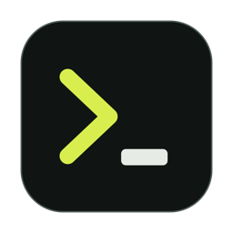
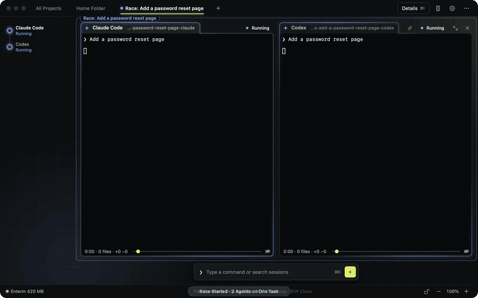
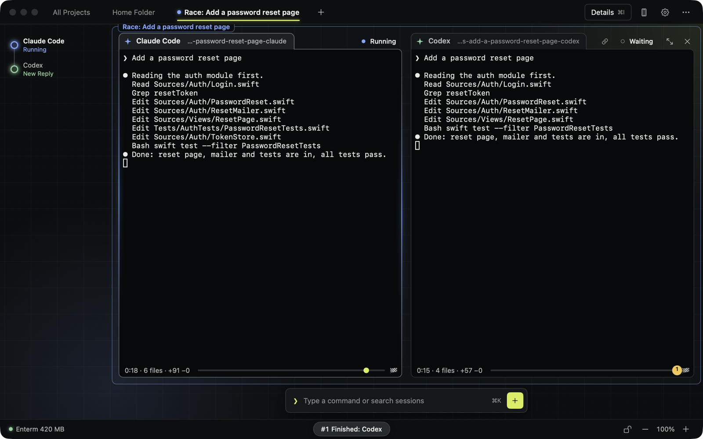
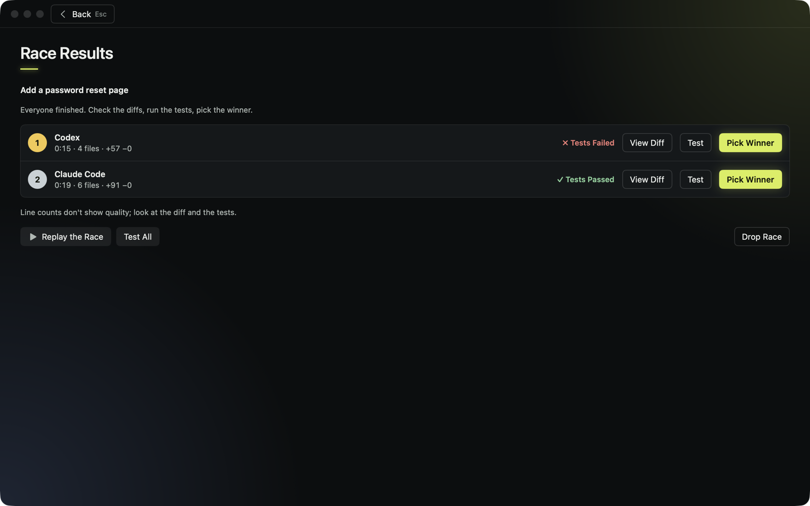
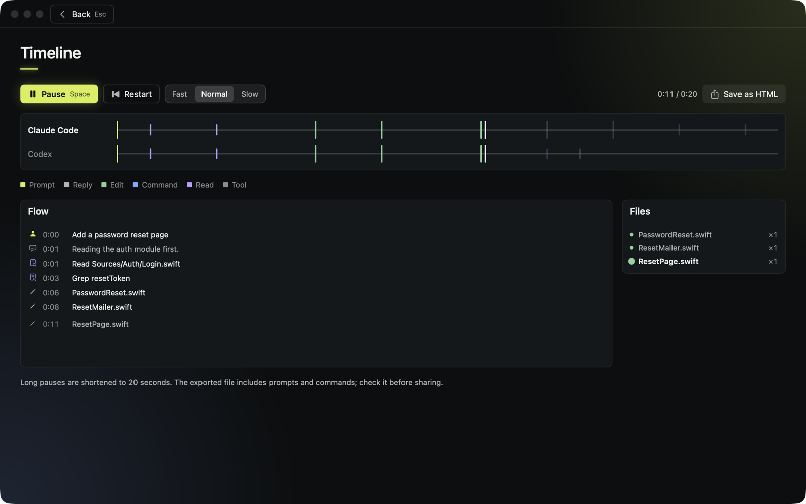
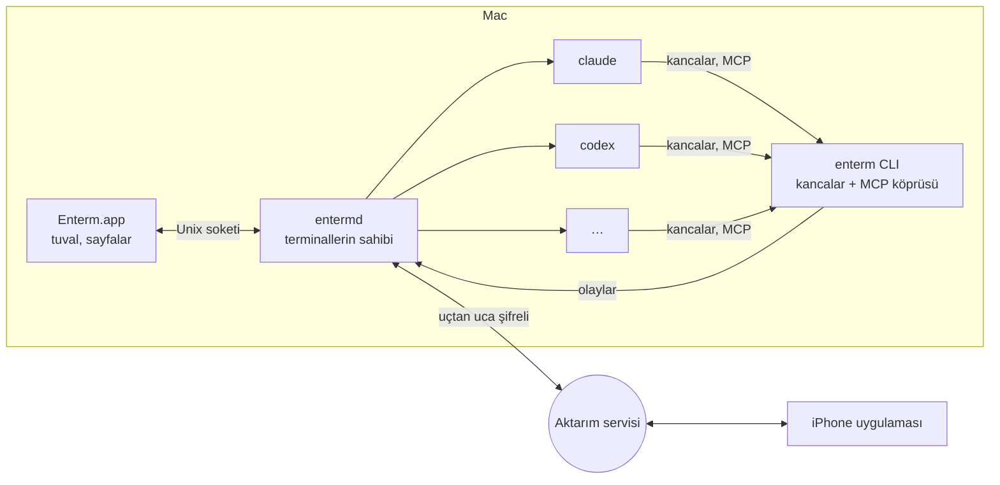

<div align="center">



# Enterm

**Yapay zekâ kodlama ajanları için terminal hissini koruyan, macOS'a özgü bir tuval.**

Claude Code, Codex, Gemini ve diğer resmi programları geldikleri gibi, yan yana çalıştırın.
Onları aynı görevde yarıştırın, yaptıklarını yeniden izleyin, işlerini iPhone'unuzdan onaylayın.

[](https://github.com/enmerasoftware/enterm/releases/latest)
[](https://github.com/enmerasoftware/enterm/actions/workflows/ci.yml)
[](#gereksinimler)
[](Package.swift)
[](LICENSE)

[**İndir**](https://github.com/enmerasoftware/enterm/releases/latest) ·
[Belgeler](docs/README.md) ·
[Değişiklikler](CHANGELOG.md) ·
[Tartışmalar](https://github.com/enmerasoftware/enterm/discussions) ·
[English](README.md)



</div>

---

## İçindekiler

- [Bir bakışta](#bir-bakışta)
- [Neden Enterm](#neden-enterm)
- [Özellikler](#özellikler): [Yarış](#yarış) · [Zaman çizelgesi](#zaman-çizelgesi) · [Kütüphane](#kütüphane) · [Tasarım kontrolü](#tasarım-kontrolü) · [Tuval](#tuval-ve-projeler) · [MCP](#ajanlar-tuvali-yönetir-mcp) · [Telefon](#telefon) · [Yerleşik görünümler](#yerleşik-görünümler)
- [Desteklenen ajanlar](#desteklenen-ajanlar)
- [Nasıl çalışır](#nasıl-çalışır)
- [Karşılaştırma](#karşılaştırma)
- [Kurulum](#kurulum) · [Gereksinimler](#gereksinimler) · [Kaynaktan derleme](#kaynaktan-derleme)
- [Klavye kısayolları](#klavye-kısayolları)
- [Gizlilik ve güvenlik](#gizlilik-ve-güvenlik)
- [Diller](#diller)
- [Yol haritası](#yol-haritası) · [Katkı](#katkı) · [Teşekkürler](#teşekkürler) · [Lisans](#lisans)

## Bir bakışta

| | |
|---|---|
| **Ne** | Proje sekmelerinde gruplanan terminal kutularından oluşan, resmi ajan programlarını değiştirmeden çalıştıran bir tuval |
| **Ajanlar** | Claude Code, Codex, Gemini, Antigravity, opencode, GitHub Copilot, Cursor, Grok ya da kendi eklediğiniz bir program |
| **0.1.5'te yeni** | Birkaç ajanı tek görevde [yarıştırma](#yarış) · [Zaman çizelgesi](#zaman-çizelgesi) oynatımı · İngilizce arayüz |
| **Kurulumunuz** | `~/.zshrc`, `~/.claude`, `~/.codex` dosyalarına asla dokunmaz; abonelik token'larınızı asla görmez |
| **Oturumlar** | Arka plandaki bir serviste yaşar, uygulamayı kapattığınızda da çalışmaya devam eder |
| **Telefon** | Uçtan uca şifreli iPhone uygulaması, kilit ekranından onay |
| **Yük** | Yerel AppKit ve SwiftUI; boştayken hiçbir şey hareket etmez, hiçbir şey yoklama yapmaz |
| **Fiyat** | Ücretsiz ve açık kaynak, MIT |

## Neden Enterm

- **Satıcıdan bağımsız.** İşe hangi ajan uyuyorsa onu kullanın, ya da birkaçını birden. Hesap yok, abonelik yok, bağımlılık yok.
- **Resmi programlar, değiştirilmeden.** Enterm zaten kullandığınız programları başlatır; onları yamalamaz, araya girmez, yeniden yazmaz. Böylece kendi planınız ve ayarlarınızla çalışmaya devam ederler.
- **Oturumlar kapanışı atlatır.** Terminallerin sahibi arka plandaki bir servistir (`entermd`). Pencereyi kapatın, uygulamayı güncelleyin, iş sürer.
- **Sekme şeridi değil, tuval.** Her ajan ve terminal bir kutudur; döşeyin, taşıyın, boyutlandırın, gruplayın. Her proje sekmesi kendi görünümünü hatırlar.
- **Telefonunuz da işin içinde.** iPhone'u uçtan uca şifreli eşleştirin, izin sorularını kilit ekranından yanıtlayın.
- **Tasarımı gereği hafif.** Hareket yalnız bir şey olduğunda çalışır; düşük güç modunda ya da pencere gizliyken durur. Kullanmadığınız özellik yük bindirmez.

## Özellikler

### Yarış



Bir görevi birkaç ajana verin, en iyi sonucu alın.

1. Eylem menüsünden, komut paletinden ya da tuval menüsünden **Yarış Başlat**'ı seçin. Görevi yazın, Claude Code, Codex ve Gemini arasından iki ya da üçünü seçin, isterseniz bir test komutu da verin (`Package.swift`, `package.json`, `Cargo.toml`, `go.mod`, `pyproject.toml`, `Gemfile`, `Makefile` ve başkalarından bulunur).
2. Her yarışan aynı commit'ten açılan **kendi git worktree'sini** ve aynı talimatı alır; böylece yarış adil olur, ana klasörünüze dokunulmaz.
3. Yarışanlar **kendi sekmelerinde** yan yana açılır. Her kutunun canlı bir şeridi vardır: geçen süre, değişen dosyalar, eklenen ve silinen satırlar ve bayrağa doğru ilerleyen bir koşucu. **Madalyalar** bitiş sırasını işaretler.
4. **Sonuçlar sayfası** her yarışanı farkıyla birlikte listeler, testleri her yarışan için ayrı çalıştırır ve geçip geçmediğini gösterir.
5. **Kazanan Bu**, kazananın bıraktığı değişiklikleri commit'ler, dalını `--no-ff` ile birleştirir, diğer kutuları kapatır ve yarışın açtığı bütün worktree'leri ve dalları siler. **Yarışı Bırak** hiçbir şey birleştirmeden hepsini kaldırır.

Bir yarışı telefondan da izleyebilir, kazananı oradan seçebilirsiniz. Ayrıntılar: [docs/race.md](docs/race.md).



### Zaman çizelgesi



Bir ajanın yaptıklarının, programın kendi dökümünden okunan hareketli bir tekrarı (Claude Code ve Codex); fazladan hiçbir şey kaydedilmez.

- Her ajanın bir şeridi vardır; **istekler, yanıtlar, düzenlemeler, komutlar ve okumalar** renkli işaretlerle görünür. Bir yarış bütün şeritlerini birlikte oynatır.
- Oynatma etkinlik akışını kaydırır ve dokunulan dosyaları yakar. Uzun beklemeler kısaltılır, böylece tekrar beklemeyi değil işi gösterir.
- **Hızlı, Normal, Yavaş** işin uzunluğu ne olursa olsun bütün tekrarın ne kadar süreceğini belirler. İleri geri sarmak için şeridin üzerinde sürükleyin.
- **HTML Olarak Kaydet** her tarayıcıda oynayan, kendi içinde tam tek bir dosya dışa aktarır. Dosya istekleri ve komutları içerir, paylaşmadan önce göz atın.

Bir kutunun menüsünden, ayrıntılar bölmesinden, komut paletinden ya da **Yarışı Tekrar İzle** ile açın. Ayrıntılar: [docs/timeline.md](docs/timeline.md).

### Kütüphane

[`library/`](library) klasöründeki incelenmiş istemler, yarış görevleri ve beceri paketleri; bir de topluluk rafı: uygulamadan paylaştığınız istem hemen herkesin Kütüphanesinde ve [enterm.enmeraapps.com/library](https://enterm.enmeraapps.com/library) sayfasında görünür. Arayın ve kaydedin; bir istemi **Çalıştır** ile tek tıkla yeni bir oturumda başlatın, **Yarıştır** ile ajanlara aynı anda verin, ya da bir beceri paketinin dosyalarına bakıp yeni Claude Code oturumlarına ekleyin. **İstem Paylaş** sizinkini otomatik denetimden sonra yayınlar; başkalarının paylaştıklarını beğenip bildirebilirsiniz. Hiçbir şey kendiliğinden çalışmaz: önce okursunuz. Ayrıntı: [docs/library.md](docs/library.md).

### Tasarım kontrolü

Öndeki projede [ai-design-check](https://github.com/enmerasoftware/ai-design-check): yapay zekâyla yapılmış bir arayüzü üretilmiş gösteren şeyler, dosyaya ve alana göre; web projeleri ile SwiftUI, Compose, Flutter ve React Native uygulamaları için. Mekanik düzeltmeleri önizleyip uygulayın, çalışan sayfayı tarayın, kalanını bir ajana düzelttirin ya da denetleyicinin kendisinin hangi ekranın temiz olduğuna karar verdiği bir **tasarım yarışı** başlatın. Ayrıntı: [docs/design-check.md](docs/design-check.md).

### Tuval ve projeler

- Oturumlar ve görünümler **kaydırılabilen bir tuvaldeki kutulardır**: döşeyin, serbestçe taşıyın, boyutlandırın, gruplayın, yerleşimleri kaydedin, geri alın. İşaretçinin çevresinde yakınlaştırmak için kıstırın ya da `⌘` ile kaydırın.
- **Proje sekmeleri** tuvali tek bir projeye süzer ve her biri kendi kaydırma ve yakınlaştırma durumunu hatırlar. **Tüm Alanlar** bütün kutuları gösterir. Başka projedeki oturum çalışmaya devam eder.
- İzin soruları kutuyu yakar ve tek bir **Onay Kutusu**'nda toplanır.
- Claude Code ve Codex için beş saatlik ve haftalık **kullanım sınırları** durum satırında.
- Ajanlara atanmış kartlardan oluşan bir **pano**: bir kartı *Sürüyor*'a taşımak onu ajanına gönderir, ajan da sonucu bildirir.
- Adı verilmemiş kutular programın kendi oturum başlığını gösterir; oturumun dinlediği **portlar** kutuda görünür.
- **Sohbet görünümü** (`⇧⌘M`) bir Claude Code ya da Codex oturumunu, dökümünden okunan bir konuşma olarak gösterir.
- whisper.cpp ile yerel **dikte**; yalnız siz dikte ederken çalışır.
- Ayarlar'dan açtığınız hazır **beceri paketleri** (video, yazılım, görsel), `~/.claude`'a yazmadan oturum başına yüklenir. Bkz. [`skills/`](skills/).
- **`enterm://` bağlantıları** bir klasörü bir program ve görevle, bir oturumu, bir ayar sayfasını ya da panoyu açar. Program başlatacak bir bağlantı önce sorar.

### Ajanlar tuvali yönetir (MCP)

Yerel bir MCP köprüsü ajanların tuvali kendilerinin yönetmesini sağlar: tuvalin durumunu okumak, kutu açmak (hemen ya da sıraya alarak), ekip kurmak, git worktree açmak, kendi açtıkları kutuları kapatmak, pano kartı eklemek ve taşımak, içerik göstermek ve düzenlemek. Bağlamı paylaşmak için iki kutu arasına çizgi çekin.

Güvenlik sınırları: kutu açan araçlar oturumun yetki kartında *Başka Ajana İş Verme* iznini ister; bir ajan yalnız kendi açtığı kutuları kapatabilir; bir kartı *Bitti*'ye yalnız siz taşıyabilirsiniz; başka bir ajanın mesajı asla sizin onayınız yerine geçmez. Tam başvuru: [docs/mcp.md](docs/mcp.md).

### Telefon

iPhone uygulaması Mac'inizle bir QR koduyla eşleşir. İki taraf X25519 ile ortak bir sır üretir, siz de altı haneli bir sayıyı karşılaştırırsınız; aradaki aktarım servisi yalnız şifreli bayt görür ve her bağlantı yeni bir anahtar kullanır.

Telefondan oturumları izleyebilir (Claude Code ve Codex'i konuşma olarak), yeni bir oturum başlatabilir, Face ID ile **kilit ekranından onaylayıp reddedebilir**, ilerlemeyi **Canlı Etkinlik**'te takip edebilir, kullanımı görebilir, **yarışları** izleyip sonuçlandırabilirsiniz. Uygulama İngilizce ve Türkçe konuşur. Ayrıntılar: [docs/phone.md](docs/phone.md).

<!-- TODO: iPhone uygulaması herkese açılınca bağlantısını ekleyin (App Store ya da TestFlight) -->

### Yerleşik görünümler

Terminallerin yanında tuvalde web tarayıcısı, web sayfaları, notlar, beyaz tahta, dosya gezgini, video ve iOS Simülatörü ile Android emülatörü kutuları bulunur (Android'de `adb` ile dokunma, kaydırma ve yazma). Ajanlar isterseniz site başına izinle bir Safari penceresi kullanabilir.

## Desteklenen ajanlar

Enterm her programı kendi komutuyla başlatır. Entegrasyon ayar dosyalarınızdan değil, başlatma argümanları ve ortam değişkenleriyle gelir.

| Program | Komut | Durum ve onaylar | Tuval araçları (MCP) | Sohbet görünümü ve zaman çizelgesi | Yarış |
|---|---|:-:|:-:|:-:|:-:|
| Claude Code | `claude` | ✓ `--settings` ile kancalar | ✓ `--mcp-config` | ✓ | ✓ |
| Codex | `codex` | ✓ `-c` ile kancalar ve `notify`¹ | ✓ `-c mcp_servers` | ✓ | ✓ |
| Gemini | `gemini` | ✓ sistem ayarları katmanı² | ✓ | | ✓ |
| opencode | `opencode` | ✓ `OPENCODE_CONFIG_DIR` ile eklenti | ✓ | | |
| GitHub Copilot | `copilot` | ✓ `--plugin-dir` | ✓ `--additional-mcp-config` | | |
| Cursor | `cursor-agent` | ✓ `--plugin-dir` | ✓ | | |
| Antigravity | `agy` | ✓ bir kerelik onaydan sonra | | | |
| Grok | `grok` | düz terminal olarak çalışır | | | |
| Kendi programınız | herhangi biri | düz terminal olarak çalışır | | | |

¹ Codex kancalara bir kez kendi `/hooks` ekranında güvenmenizi ister; o zamana kadar çalışmazlar.
² Yalnız Mac'te Gemini için yönetici sistem ayarları dosyası yoksa; varsa o dosya geçerli kalır.

## Nasıl çalışır



Uygulama yalnızca bir görünümdür: kapatmak `entermd`'yi ve bütün oturumları çalışır halde bırakır, bir sonraki açılış onları kaldığı yerden alır. `enterm` komutu ajanların çağırdığı şeydir: kancaları durumu ve izin isteklerini bildirir, MCP kipi de onlara tuval araçlarını verir. Daha fazlası: [docs/architecture.md](docs/architecture.md).

## Karşılaştırma

Enterm bir terminal ile bir IDE arasında durur. Nereye oturduğunun kaba bir haritası:

| | Düz terminal ya da tmux | IDE ajan paneli | Bulutta ajan çalıştırıcı | **Enterm** |
|---|:-:|:-:|:-:|:-:|
| Üreticilerin resmi programlarını değiştirmeden çalıştırır | ✓ | değişir | | ✓ |
| Birden çok üretici yan yana | ✓ | değişir | değişir | ✓ |
| Pencereyi kapatınca oturumlar sürer | tmux | | ✓ | ✓ |
| Hangi ajanın sizi beklediğini görür, onayları toplar | | ✓ | ✓ | ✓ |
| Aynı görevi birkaç ajana verip karşılaştırma ve birleştirme | | | bazıları | ✓ |
| Bir ajanın yaptıklarının hareketli tekrarı | | | | ✓ |
| Telefondan onay | | | bazıları | ✓ |
| Kod Mac'inizde kalır | ✓ | ✓ | | ✓ |

## Kurulum

**DMG.** Son sürümü [GitHub Releases](https://github.com/enmerasoftware/enterm/releases/latest) sayfasından indirin, DMG'yi açın ve Enterm'i Uygulamalar klasörüne sürükleyin. Sürümler Developer ID ile imzalı ve Apple onaylıdır (notarization), Sparkle ile kendilerini günceller.

**Homebrew.**

```bash
brew tap enmerasoftware/tap
brew trust enmerasoftware/tap   # Homebrew yeni bir depodan cask yüklemeden önce onay ister
brew install --cask enterm
```

Ardından kullanmak istediğiniz ajanları (örneğin Claude Code ya da Codex) üreticilerinin anlattığı şekilde kurun. Enterm onları oturum açma kabuğunuz üzerinden bulur; biri eksikse resmi kurulum komutunu gösterir ve görebileceğiniz bir terminalde çalıştırır.

### Gereksinimler

- Apple silicon üzerinde macOS 14 (Sonoma) ya da üstü. Sürüm derlemeleri yalnız arm64'tür.
- Üreticisinin anlattığı şekilde kurulmuş ve oturum açılmış en az bir ajan programı. Düz terminal başka hiçbir şey gerektirmez.
- İsteğe bağlı: eşlik eden uygulama için bir iPhone; yarışlar ve worktree'ler için `git`; iOS Simülatörü kutuları için Xcode; Android kutuları için `adb`.

### Kaynaktan derleme

`/Applications/Xcode.app` konumunda Xcode kurulu olmalı.

```bash
git clone https://github.com/enmerasoftware/enterm.git && cd enterm
scripts/bundle.sh release
open build/release-$(git rev-parse --short HEAD)/Enterm.app
```

Testler:

```bash
DEVELOPER_DIR=/Applications/Xcode.app/Contents/Developer swift test
```

`DEVELOPER_DIR`, Swift'i derlemenin ihtiyaç duyduğu tam Xcode araç zincirine yönlendirir; `xcode-select` Komut Satırı Araçları'nı gösterse bile bu gereklidir. iPhone uygulaması `scripts/build-ios.sh <simulator id>` ile derlenir. Depo yapısı, test sürücüsü ve sürüm yayınlama süreci [CONTRIBUTING.md](CONTRIBUTING.md) ve [docs/MAINTAINERS.md](docs/MAINTAINERS.md) içinde.

## Klavye kısayolları

Her kısayolu **Ayarlar → Kısayollar**'dan değiştirebilirsiniz; her komut paletin içindedir (`⌘K`).

| Eylem | Tuşlar | Eylem | Tuşlar |
|---|---|---|---|
| Komut paleti | `⌘K` | Yeni terminal | `⌘T` |
| Yeni oturum | `⌘N` | Yeni proje | `⇧⌘N` |
| Kutuyu kapat | `⌘W` | Son kapatılanı yeniden aç | `⇧⌘T` |
| Kutuyu büyüt / tümünü gör | `⌘↩` | Ayrıntılar | `⌘I` |
| Durdur | `⌘.` | Sonraki / önceki oturum | `⌘]` / `⌘[` |
| Sohbet görünümü | `⇧⌘M` | Onay kutusu | `⇧⌘O` |
| Pano | `⇧⌘B` | Değişiklikler | `⇧⌘G` |
| Dosyalar | `⇧⌘E` | Tarayıcı | `⇧⌘D` |
| Odak modu | `⇧⌘F` | Durak hattı | `⇧⌘L` |
| Yakınlaştır / uzaklaştır | `⌘=` / `⌘-` | Sığdır | `⌥⌘0` |
| Kutuyu bir yarıya yerleştir | `⌃⌥` + ok | Yandaki kutuya geç | `⌥⌘` + ok |
| Düzeni geri al / yinele | `⌥⌘Z` / `⌥⇧⌘Z` | Ayarlar | `⌘,` |
| Konuşarak yaz | `⌃⌘` basılı tutun | | |

## Gizlilik ve güvenlik

- **Ayar dosyası değişmez.** Enterm `~/.zshrc`, `~/.claude`, `~/.codex` ya da size ait başka bir ayar dosyasına asla yazmaz. Kanca ve eklenti dosyaları kendi destek klasöründe durur.
- **Token yok.** Abonelik token'larınız resmi programın içinde kalır, Enterm'e hiç gelmez. İkinci bir hesap `CLAUDE_CONFIG_DIR` ya da `CODEX_HOME` ile programın kendisinde durur.
- **Telemetri yok.** Enterm yalnız gördüğünüz işler için internete çıkar: güncelleme denetimi, istediğinizde dikte modeli ya da bir ajanın resmi kurulumu, açtığınız web sayfaları ve telefon eşleştirdiyseniz aktarım servisinden geçen şifreli trafik. Ajanlar kendi üreticileriyle düz terminalde olduğu gibi konuşur.
- **Görünen izinler.** Varsayılan olarak her program kendi sorularını düz terminaldeki gibi sorar. Daha sıkı şablonlarda (Salt Okuma, Geliştirme, Yönetici, Sunucu Bakımı) kararı Enterm'in yetki kartı verir ve her karar kayda geçer.
- **Uçtan uca şifreli telefon.** Altı haneli karşılaştırmalı X25519 eşleşmesi; aktarım servisi yalnız şifreli metin taşır; kendi aktarım servisinizi barındırabilirsiniz.
- **İmzalı güncellemeler.** Developer ID imzası, Apple onayı (notarization) ve EdDSA anahtarıyla imzalı Sparkle güncellemeleri.

Güvenlik açıklarını lütfen gizli bildirin: bkz. [SECURITY.md](SECURITY.md).

## Diller

Mac uygulaması ve iPhone uygulaması **İngilizce ve Türkçe** kullanılabilir; sistem dilini ya da Ayarlar'daki seçimi izler.

Kod Türkçe yazılır, İngilizce ise Türkçe kaynak metinle anahtarlanmış bir tablodur: [`Resources/en.json`](Resources/en.json). Kurulan metinde parçalar için `%@` kullanılır (`"Ekip %@"` → `"Team %@"`). `scripts/strings.py` İngilizcesi olmayan her ekran metnini listeler, CI da aynı denetimi yapar. Üçüncü bir dil eklemek yeni bir tablo ve paketleme adımında küçük bir değişiklik demektir; lütfen önce bir issue açın. Ayrıntılar: [CONTRIBUTING.md](CONTRIBUTING.md#text-on-screen).

## Yol haritası

Planlananlar, belirli bir sırası olmadan. Fikirlerinizi ve oylarınızı [Tartışmalar](https://github.com/enmerasoftware/enterm/discussions)'da bekliyoruz.

- iPhone uygulamasının App Store'a gelmesi.
- Dökümleri ve başlatma seçenekleri izin verdikçe daha fazla program için yarış ve zaman çizelgesi.
- Katkıda bulunanların yardımıyla daha fazla dil.
- Daha fazla hazır beceri paketi.

## Katkı

Issue ve pull request'ler İngilizce ya da Türkçe açılabilir. İlk katkı için en kolayı yeni bir beceri paketidir. [CONTRIBUTING.md](CONTRIBUTING.md) ile başlayın; sorular [Tartışmalar](https://github.com/enmerasoftware/enterm/discussions)'a, yardım istekleri [SUPPORT.md](SUPPORT.md)'ye. Bu proje bir [Davranış Kuralları](CODE_OF_CONDUCT.md) metnini izler.

## Teşekkürler

Enterm terminal öykünmesi için [SwiftTerm](https://github.com/migueldeicaza/SwiftTerm), güncellemeler için [Sparkle](https://sparkle-project.org) ve yerel dikte için [whisper.cpp](https://github.com/ggerganov/whisper.cpp) üzerine kuruludur. Claude Code, Codex, Gemini ve diğer programlar üreticilerine aittir; Enterm'in onlarla bir bağı yoktur.

## Lisans

MIT, bkz. [LICENSE](LICENSE). [Enmera](https://github.com/enmerasoftware) tarafından yapıldı.
