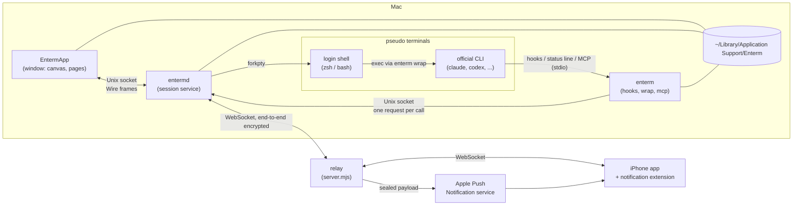
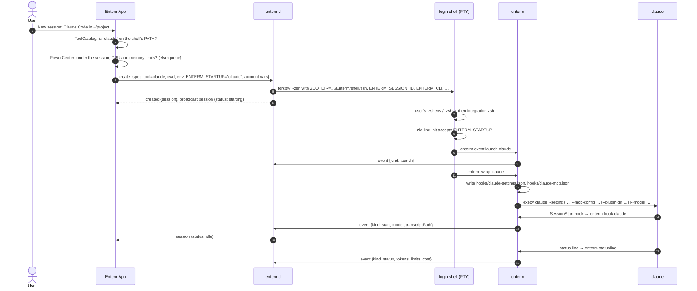
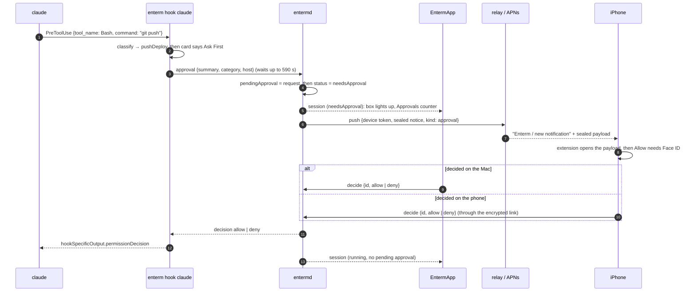

# Architecture

How Enterm is put together: the processes, how they talk, how the official agent CLIs are wired in without touching your configuration, where state lives, and the rules that keep the app idle when nothing happens.

**On this page**

- [Components](#components)
- [Processes](#processes)
- [The local socket and the Wire protocol](#the-local-socket-and-the-wire-protocol)
- [Sessions and pseudo terminals](#sessions-and-pseudo-terminals)
- [Shell integration](#shell-integration)
- [How each agent is integrated](#how-each-agent-is-integrated)
- [Session status](#session-status)
- [Approvals and the permission card](#approvals-and-the-permission-card)
- [Sequence: starting an agent session](#sequence-starting-an-agent-session)
- [Sequence: an approval request](#sequence-an-approval-request)
- [Environment variables](#environment-variables)
- [State files](#state-files)
- [Files Enterm may write outside its own folder](#files-enterm-may-write-outside-its-own-folder)
- [Resource use and the motion rule](#resource-use-and-the-motion-rule)
- [Localization](#localization)

## Components

| Target | Kind | Role |
| --- | --- | --- |
| `Sources/EntermApp` | macOS app (`EntermApp`) | The window. Canvas and terminals in AppKit (terminal emulation by [SwiftTerm](https://github.com/migueldeicaza/SwiftTerm)), pages and dialogs in SwiftUI. Updates through Sparkle. |
| `Sources/entermd` | background service | Owns every pseudo terminal. Keeps sessions alive when the window quits. Holds approvals, file locks, the heavy-command queue and paired phones (`PhoneCenter.swift`). |
| `Sources/enterm` | small CLI | Called by the shell integration and by agent hooks; launches the official CLIs with Enterm's arguments (`enterm wrap`); serves the local MCP bridge (`enterm mcp`, see [mcp.md](mcp.md)). |
| `Sources/EntermCore` | library | UI-free core shared by all of the above and compiled into the iPhone app: the Wire protocol, session model, permissions, pairing and encryption, localization, transcript parsing, race and timeline logic. It imports no AppKit, UIKit or SwiftUI. |
| `Sources/CPTY` | C target | A thin `forkpty` wrapper (`cpty_spawn`, `cpty_resize`). |
| `enterm-ios/` | iPhone app | Companion app, Notification Service Extension (`EntermNotify`) and Live Activity widget (`EntermWidgets`). See [phone.md](phone.md). |
| `relay/` | Node server | Carries encrypted bytes between Mac and phone and forwards sealed notifications to APNs. No dependencies. |

All three macOS executables ship inside the app bundle at `Enterm.app/Contents/MacOS/` (`EntermApp`, `entermd`, `enterm`), as `scripts/bundle.sh` assembles it.



## Processes

**`EntermApp`** is the window. On launch it connects to the service socket; if nothing answers it starts `entermd` from the same `MacOS` folder and retries every 50 ms, up to 40 times (`ServiceConnection.connect`). The window never owns a terminal process.

**`entermd`** is the session service. At start it calls `setsid()`, ignores `SIGPIPE`, creates its directories, rewrites the shell-integration files and binds the socket. If another `entermd` already answers on the socket, the new one exits immediately, so there is only ever one per user. It does nothing until a program writes or a client speaks, and it exits by itself 30 seconds after the last client has disconnected **and** every session has exited (`scheduleIdleCheck`). Sessions therefore survive quitting the app; they do not survive a reboot or logout, because the pseudo terminals die with the service.

**`enterm`** is a short-lived command. Every hook call, status-line call and `enterm event` opens the socket, sends one message, optionally waits for one reply and exits. It writes nothing to stdout unless the calling program reads stdout as a decision (Claude Code's `PreToolUse` and `PermissionRequest` hooks, Cursor's `beforeSubmitPrompt`). `enterm mcp` is the exception: the agent keeps it running as its MCP server for the life of the agent session.

When the app is updated while the old service is still running, the service reports a build stamp (the modification time of its executable, `EntermVersion.stamp`). If it differs from the bundled `entermd`, the app either restarts the service silently (no open sessions) or shows a **New Version Ready** button in the top bar ([troubleshooting](troubleshooting.md#the-top-bar-says-new-version-ready)).

## The local socket and the Wire protocol

The socket lives at `/tmp/enterm-<uid>/entermd.sock` (socket paths are limited to 104 bytes, so it is not in Application Support). The directory is created with mode `0700` and the socket is `chmod 0600`; it is bound under `umask 077`. `ENTERM_SOCKET` overrides the path.

Every message is a frame (`Sources/EntermCore/Wire.swift`):

```
[u32 length, big endian][u8 kind][payload]      length = payload bytes + 1
```

| Kind | Value | Payload |
| --- | --- | --- |
| `json` | 0 | A `WireMessage` encoded as JSON |
| `output` | 1 | `[u32 session number][bytes]`, terminal output, service to client |
| `input` | 2 | `[u32 session number][bytes]`, keystrokes, client to service |
| `replay` | 3 | `[u32 session number][bytes]`, past output sent when a client attaches |

The decoder drops its buffer if a frame claims a length of 0 or 64 MiB or more.

`WireMessage` is deliberately one flat JSON shape for both requests and events (`op`, `id`, `number`, `spec`, `sessions`, `session`, `rows`, `cols`, `event`, `text`, `error`, `version`, `decision`, `limit`, `offset`), "to keep the protocol readable from any language". `protocolVersion` is `1`. A request that carries an `id` gets its reply with the same `id`.

Operations the service understands (`Sources/entermd/main.swift`, `handleMessage`):

| `op` | Sent by | Effect |
| --- | --- | --- |
| `hello` | app, phone | Subscribe to broadcasts. Reply `state` with all sessions, protocol version and build stamp. The app also reports the path of its bundled `enterm`. |
| `create` | app, phone | Spawn a session from a `SessionSpec`. Reply `created`, then broadcast `session`. |
| `attach` / `detach` | app, phone | Start or stop receiving `output` for a session. Attach first sends the ring buffer as `replay`. |
| `resize` | app | Resize the PTY. Ignored when it comes from a phone: only the Mac window sizes a session. |
| `kill`, `remove`, `rename`, `setGroup`, `setStatus`, `stop`, `setPriority` | app (some from phone) | Session control. `stop` sends `SIGSTOP`/`SIGCONT` to the process group; `setPriority` calls `setpriority(PRIO_PGRP, …)`. |
| `event` | `enterm` | An `AgentEvent` from a hook, the status line or the shell integration. |
| `approval` | `enterm` | Start an approval and hold the connection until it is decided. |
| `decide` | app, phone | Answer an approval (`allow`/`deny`, optional `remember`). |
| `lock` | `enterm` | Claim a file for one session (two agents never edit the same file at once). |
| `heavyStart`, `heavyDone`, `heavyList` | `enterm`, app | One heavy command (builds, test runs, `ffmpeg`, … see `HeavyWork`) at a time across sessions. |
| `tail` | MCP bridge, app | Last 40 lines of plain text from the last 16 KiB of a session's output. |
| `chat` | app, phone | Read a session's transcript from an offset (chat view). |
| `canvas`, `browser` | MCP bridge | Forwarded to the window as `canvasCmd` / `browserCmd`; the window answers `canvasReply` / `browserReply`. |
| `notify` | `enterm notify` | Broadcast a notice and send it to paired phones. |
| `scanPorts`, `reloadPermissions`, `reload`, `input`, `list` | various | Housekeeping. |
| `shutdown` | app | Hang up every session, remove the socket, exit (used by uninstall and by switching to a new service version). |
| `pairStart`, `pairConfirm`, `pairCancel`, `devices`, `deviceRemove`, `appReply`, `phoneAttention` | app | Phone pairing and the phone's calls into the window ([phone.md](phone.md)). |

The service writes to clients without blocking. A client that stops reading is dropped once more than 32 MiB is pending for it.

## Sessions and pseudo terminals

`create` (`Service.create`) does the following:

1. Resolves the working folder (`~` expanded); a missing folder fails with "folder not found".
2. Builds the environment from the service's own environment plus the variables listed under [Environment variables](#environment-variables). It **removes** `CLAUDECODE` and every `CLAUDE_CODE_*` variable it inherited, so a session never looks like a child of another Claude Code session, then applies the spec's own variables.
3. Starts either the spec's `argv` or the user's login shell with Enterm's integration ([below](#shell-integration)). The login shell is the shell chosen in Settings if it is executable, else the account's shell from `getpwuid`, else `$SHELL`, else `/bin/zsh`; `ENTERM_SHELL` overrides it.
4. Calls `cpty_spawn`. A shell starts at most 20 columns wide and is resized to the requested size a moment later, because zsh draws its end-of-line mark as wide as the terminal before any hook runs.
5. Registers a read source on the PTY master and a process source for the child's exit.

Output goes into a per-session ring buffer of 1 MiB (trimmed back to 1 MiB once it passes 1.25 MiB) and is sent to every attached client. The session list and the last 256 KiB of each changed session's output are written to disk at most once every 15 seconds, and only when something changed (`persistSoon`). Output tails are only written while **Settings → Session Protection → Keep Terminal Transcript** is on (it is on by default; the setting notes the file is unencrypted). Each tail is `0600`.

When a session's process exits, the service records the exit code, releases its file locks, removes it from the heavy-command queue and answers any approval it was waiting on with `none`.

If the app opens and the service has no sessions but `sessions.json` lists some (the Mac restarted), the app shows **Bring Sessions Back?**. Agents are not restarted on their own; **Resume** starts each one again with the program's own resume argument (`claude --resume <transcript>`, `codex resume <id>`, `agy --conversation=<id>`), and a plain terminal reopens with its saved output followed by a "computer restarted" banner (`Restore` in `PagesWork.swift`).

## Shell integration

Integration arrives through start arguments and environment variables. The user's `.zshrc`, `.zshenv`, `.bashrc` and `.bash_profile` are read, never written (`Sources/EntermCore/ShellIntegration.swift`).

- **zsh.** The service sets `ZDOTDIR` to `~/Library/Application Support/Enterm/shell/zsh` (remembering any existing `ZDOTDIR` in `ENTERM_USER_ZDOTDIR`) and starts `-zsh`. Enterm's `.zshenv` there restores the user's `ZDOTDIR`, sources the user's own `.zshenv`, and, for interactive shells, `integration.zsh`. That file installs itself from the first `precmd` hook, which runs after the user's `.zshrc`.
- **bash.** Started as `bash --init-file …/shell/init.bash`. That file sources `/etc/profile` and then the first of `~/.bash_profile`, `~/.bash_login`, `~/.profile`, `~/.bashrc`, as a login shell would, and adds a `PROMPT_COMMAND`.
- **Other shells** start as a plain login shell (`-<name>`) with no integration.

The integration does three things:

1. Reports the working directory after every prompt with OSC 7.
2. Defines a shell function for each of `claude codex agy gemini opencode grok copilot cursor-agent` (skipped in zsh when you already have an alias of that name). The function reports `enterm event launch <tool>`, runs `enterm wrap <tool> "$@"`, then reports `enterm event launchEnd <tool>`. If `$ENTERM_CLI` is not executable it falls back to `command <tool>`, so the integration can never stop the real program from starting.
3. Hooks `command_not_found_handler` (zsh) or checks exit code 127 (bash) for those names and reports `enterm event cnf <tool>`, which drives the "not installed" cards ([troubleshooting](troubleshooting.md#a-program-is-not-installed-or-not-on-path)).

When a session should start a program, the app does not type into the terminal. It sets `ENTERM_STARTUP` to the command line; the integration places it in the zsh line editor and accepts it (a `zle-line-init` widget), or `eval`s it from `PROMPT_COMMAND` in bash, exactly once. The command therefore runs through the user's own shell, `PATH`, aliases and functions.

## How each agent is integrated

`enterm wrap <tool> <args…>` (`Sources/enterm/main.swift`) finds the real program on `PATH`, adds Enterm's arguments or variables, removes `ENTERM_MODEL`, `ENTERM_EFFORT`, `ENTERM_ADVISOR` and `ENTERM_STARTUP` from the environment and `execv`s it. Nothing is added when the arguments contain any of `--help -h --version -v update install doctor mcp auth login logout`. All generated files live under `~/Library/Application Support/Enterm/hooks/` and are rewritten on each launch; none of them is in the program's own configuration folder.

| Program | Command | What Enterm adds | Status source | Approvals through Enterm | MCP bridge |
| --- | --- | --- | --- | --- | --- |
| Claude Code | `claude` | `--settings hooks/claude-settings.json` and `--mcp-config hooks/claude-mcp.json` (each only if you did not pass that flag yourself); one `--plugin-dir` per enabled skill pack; `--model`, `--effort` and `--advisor` from the model plan chosen in Enterm (only what was chosen); `ENTERM_USER_STATUSLINE` set to your own status-line command so it keeps running | Hooks: `SessionStart`, `UserPromptSubmit`, `Stop`, `StopFailure`, `Notification`, `SubagentStart`, `SubagentStop`, `PreToolUse` and `PermissionRequest` (600 s timeout), `PostToolUse`; plus the status line (model, effort, tokens, context, cost, 5-hour and weekly limits) | Yes | Yes |
| Codex | `codex` | `-c notify=["<enterm>","notify-codex"]`; `-c mcp_servers.enterm.command=…` and `.args=["mcp"]`; `-c hooks.<Event>=…` for `SessionStart`, `UserPromptSubmit`, `PreToolUse`, `PermissionRequest`, `Stop`, `SubagentStart`, `SubagentStop` | `notify` (end of turn) always; the hooks only after you trust them in Codex's `/hooks` screen ([troubleshooting](troubleshooting.md#codex-status-needs-your-approval)) | Yes, once hooks are trusted | Yes |
| Gemini CLI | `gemini` | `GEMINI_CLI_SYSTEM_SETTINGS_PATH=hooks/gemini-system.json` with hooks (`SessionStart`, `BeforeAgent`, `BeforeTool`, `AfterAgent`, `Notification`) and the MCP server, **only if** that variable is unset and `/Library/Application Support/GeminiCli/settings.json` does not exist (an administrator's system settings stay in charge) | Hooks (report only) and output activity | No, the program's own prompt | Yes, when the settings layer is applied |
| opencode | `opencode` | `OPENCODE_CONFIG_DIR=hooks/opencode` containing `plugins/enterm.js`, and `OPENCODE_CONFIG_CONTENT` with an inline MCP entry, each only if you have not set that variable | Plugin events (report only) and output activity | No | Yes, unless you set `OPENCODE_CONFIG_CONTENT` |
| GitHub Copilot CLI | `copilot` | `--plugin-dir hooks/copilot-plugin` (unless passed) and `--additional-mcp-config @hooks/copilot-mcp.json` | Plugin hooks (report only) and output activity | No | Yes |
| Cursor CLI | `cursor-agent` | `--plugin-dir hooks/cursor-plugin` (unless passed), with hooks `beforeSubmitPrompt`, `afterAgentResponse`, `stop` and an MCP entry | Plugin hooks (report only) and output activity | No | Yes |
| Antigravity | `agy` | Nothing on the command line. Before the first start in a folder it prints a one-time notice about Antigravity's terms and waits for Enter (remembered in `antigravity-acknowledged.json`). Optionally, after you press **Write to This Folder** in the session details, Enterm writes `.agents/hooks.json` into the project | Output activity; hooks (`Stop`, `PreInvocation`) only with that file | No | No |
| Grok | `grok` | Nothing | Output activity | No | No |
| Custom program | as configured | Nothing; the start line is typed into the shell as you wrote it | Output activity | No | No |

The hooks of Gemini, Copilot and Cursor only report state. As the code puts it, approvals stay in the program's own prompt, "so a wrong guess here can never allow anything".

**Accounts.** An extra subscription account added in Enterm is only a directory, `~/Library/Application Support/Enterm/accounts/<id>/`, passed to the official program as `CLAUDE_CONFIG_DIR` (Claude Code) or `CODEX_HOME` (Codex). The program signs in and keeps its own tokens there; Enterm never reads them. An API-key account is different: the key you type is stored in the macOS Keychain (service `tr.com.enmera.enterm.apikey`) and passed as `ANTHROPIC_API_KEY` or `OPENAI_API_KEY` to sessions that use that account.

**Model gateway.** With **Settings → Model Gateway** on, Claude Code sessions on the default account start with `ANTHROPIC_BASE_URL` (and `ANTHROPIC_MODEL` if set), and the start line is prefixed with `ANTHROPIC_AUTH_TOKEN="$<your variable>"`. Only the variable's name is stored; the shell expands it.

## Session status

`SessionStatus` is one of `starting`, `running`, `idle`, `needsApproval`, `limitReached`, `failed`, `queued`, `unknown`, `notFound`, `exited`. Plain terminals only use `running` and `exited`.

- Claude Code and Codex report their state through hooks (`ToolKind.reportsStatus`).
- Every other program is read from its output: any output means `running`; three quiet seconds mean `idle` (`noteActivity`).
- A session opened for a program that never sends its launch event (for example because an alias bypasses the shell function) moves from `starting` to `unknown` after 30 seconds.
- Claude Code's hooks wait until the folder is trusted, so while starting, the word "trust" on screen marks the session `needsApproval`.
- For Codex, which only reports the end of a turn, pressing Enter in an idle session marks it `running`.

After a turn ends, or when a program is launched, the service looks for TCP ports the session's process tree listens on (`ps` and `lsof`), three times at 1.5, 6 and 20 seconds. There is no polling timer.

## Approvals and the permission card

Each session has a **permission card** (`PermissionBook` in `permissions.json`): a mode of **Allowed**, **Ask First** or **Off** for seven categories, **File Editing**, **Deleting**, **SSH**, **Internet**, **Assigning Work to Other Agents**, **Push and Deploy**, **Running Commands**. Sessions without their own card use the default template (**Settings → Security → Default Template for New Sessions**).

| Template | Files | Delete | SSH | Internet | Delegate | Push/Deploy | Commands |
| --- | --- | --- | --- | --- | --- | --- | --- |
| **Open** (default) | pass-through | pass-through | pass-through | pass-through | pass-through | pass-through | pass-through |
| Read Only | Off | Off | Off | Ask | Off | Off | Ask |
| Development | Allowed | Ask | Off | Ask | Allowed | Off | Ask |
| Admin | Off | Off | Off | Ask | Allowed | Off | Ask |
| Server Maintenance | Ask | Ask | Ask | Ask | Off | Ask | Ask |

**Open** is a pass-through card: the program's own rules decide, as in a plain terminal, and its question appears on screen at once. With **Settings → Security → One-Click Approval** on, Claude Code's question is also shown under the box and waits up to 45 seconds for an answer there before the program's own prompt takes over.

Tool calls are classified conservatively (`PermissionClassifier`): `Edit`, `Write`, `MultiEdit`, `NotebookEdit`, `apply_patch` are file edits; `WebFetch`, `WebSearch` are internet; shell commands are split into words and checked for `ssh`/`scp`/`rsync`, `git push`/`deploy`/`gh release`/`npm publish`, `rm`/`rmdir`/`git clean`/`git reset --hard`, `curl`/`wget`; anything else is a command. SSH additionally follows the card's per-host list: when the list is non-empty, a host that is not on it is denied.

On Claude Code (and Codex with trusted hooks):

- `PreToolUse`: a category set to **Off** is denied with a reason. A category set to **Ask First** that is SSH, Push and Deploy, Deleting or Internet holds the hook and asks you in Enterm (up to 590 seconds). Edits to a file another session has locked are denied.
- `PermissionRequest` (the program would ask you itself): on a non-Open card Enterm asks you instead, up to 590 seconds; on the Open card only when One-Click Approval is on.
- Calls to Enterm's own MCP tools (`mcp__enterm__*`) are not classified and are allowed at the `PermissionRequest` step; the bridge checks links and the card itself ([mcp.md](mcp.md)). Subagents may not call them, except `ajan_listesi`.
- If the hook gives up waiting, the card disappears and the program's own question is on screen.

An allowed request is remembered for 30 seconds, so the same request passing through both hooks is not asked twice. "Remember" on an approval that names a host (an internet request, for example) adds the host to a list that allows it for all sessions.

## Sequence: starting an agent session



## Sequence: an approval request

The case shown is a non-Open card with **Push and Deploy** set to **Ask First**, and a paired phone.



## Environment variables

Set for every session by `entermd`:

| Variable | Value |
| --- | --- |
| `TERM`, `COLORTERM` | `xterm-256color`, `truecolor` |
| `TERM_PROGRAM`, `TERM_PROGRAM_VERSION` | `Enterm`, the app version |
| `ENTERM_SESSION_ID` | The session's UUID; hooks and the MCP bridge use it to identify the caller |
| `ENTERM_SOCKET` | Path of the service socket |
| `ENTERM_HOME` | Enterm's support folder |
| `ENTERM_CLI` | Path of the `enterm` command (the service's own copy, or the one the window reported if the app moved) |
| `LANG`, `LC_CTYPE` | Only when not already set: the Mac's language as a locale that exists in `/usr/share/locale`, and `UTF-8` |
| `PWD` | The working folder |
| `ZDOTDIR`, `ENTERM_USER_ZDOTDIR` | zsh only, see [Shell integration](#shell-integration) |

Set by the app for particular sessions: `ENTERM_STARTUP` (the command to run once), `ENTERM_MODEL`, `ENTERM_EFFORT`, `ENTERM_ADVISOR` (consumed and removed by `enterm wrap`), `CLAUDE_CODE_SUBAGENT_MODEL` (model plan), `CLAUDE_CONFIG_DIR` / `CODEX_HOME` / `ANTHROPIC_API_KEY` / `OPENAI_API_KEY` (accounts), `ANTHROPIC_BASE_URL` / `ANTHROPIC_MODEL` (gateway).

Overrides read by Enterm itself:

| Variable | Effect |
| --- | --- |
| `ENTERM_HOME` | Use another support folder instead of `~/Library/Application Support/Enterm` |
| `ENTERM_SOCKET` | Use another socket path |
| `ENTERM_SHELL` | Use this shell for sessions and for detecting installed programs |
| `ENTERM_SKILLS_DIR` | Load skill packs from this folder instead of the app bundle |

Debug builds also read test-driver variables (`ENTERM_DEBUG_DIR`, `ENTERM_START_TERMINAL`, `ENTERM_RELAY`, `ENTERM_SSH`, …); see [MAINTAINERS.md](MAINTAINERS.md#test-sürücüsü) (Turkish).

## State files

Everything lives in `~/Library/Application Support/Enterm/` (`EntermPaths.support`, overridable with `ENTERM_HOME`). Directories are created `0700`; JSON files are written atomically with `0600` (`JSONStore`).

| Path | Written by | Contents |
| --- | --- | --- |
| `sessions.json` | service | Session list (for restore after a restart) |
| `scrollback/<session-id>.log` | service | Last 256 KiB of output per session, if Keep Terminal Transcript is on |
| `shell/` | service | `zsh/.zshenv`, `integration.zsh`, `init.bash` |
| `hooks/` | `enterm` | Generated hook, plugin and MCP configuration for each program |
| `settings.json` | app | Settings |
| `state.json` | app | Canvas layout, groups, projects, which agent opened which box |
| `permissions.json` | app, service | Permission cards, default template, remembered internet hosts |
| `links.json` | app | Lines drawn between boxes (links) |
| `board.json`, `team.json` | app, `enterm mcp` | Board cards; team and reports |
| `mail/` | `enterm mcp` | Messages agents sent each other with `is_ver` |
| `accounts.json`, `accounts/<id>/` | app | Account list; config folders for extra subscriptions (the official program writes inside) |
| `devices.json` | service | Paired phones: name, relay, pairing key, push token (`0600`) |
| `races.json` | app | Races, open and finished ([race.md](race.md)) |
| `power.json` | app | Power-limit settings |
| `schedule.json`, `triggers.json`, `shortcuts.json`, `run-trust.json` | app | Scheduled jobs, triggers, shortcuts, accepted run commands |
| `written-files.json` | app | Files Enterm wrote outside this folder (removed on uninstall) |
| `antigravity-acknowledged.json` | `enterm` | Folders where the Antigravity notice was accepted |
| `browser-shots/` | app | Screenshots taken by `tarayici_goruntu` |
| `whisper/` | app | Dictation models you chose to download |

API keys you add are in the Keychain, not in these files. The socket is in `/tmp/enterm-<uid>/`.

## Files Enterm may write outside its own folder

Enterm does not write to `~/.zshrc`, `~/.claude`, `~/.codex`, `~/.gemini` or any program's configuration. A few features create files in your **project** folders, each only when you use that feature:

| File | When |
| --- | --- |
| `<repo>.worktrees/<branch>/` next to the repository | A worktree or a race ([race.md](race.md)) |
| `ekip/raporlar/<date>-<author>.md` in the team or session folder | An agent calls `rapor_yaz` ([mcp.md](mcp.md#rapor_yaz)) |
| `.agents/hooks.json` | You press **Write to This Folder** on an Antigravity session |
| `.enterm/not.md`, `.enterm/tahta/tahta.json`, `.enterm/zamanlayici.json` | Notes, whiteboard and scheduler views saved with the project |

The uninstall page lists what it removes ([faq.md](faq.md#how-do-i-uninstall-enterm)).

## Resource use and the motion rule

The design rule, from `CONTRIBUTING.md`: nothing runs while idle. In the code:

- **No timers at rest.** The service has no periodic timer; it reacts to PTY output, client messages and process exits. Its only timers are the 15-second persistence flush (armed by a change), the 30-second idle exit, and one-shot checks after a session starts or a turn ends. The relay link waits on the network with no keep-alive of its own.
- **Power limit sampling** (`PowerCenter`) runs every 5 seconds only while an agent is running, a session is queued or more than one session exists. Near the CPU target (90% of it), background agents get a lower scheduling priority (`setpriority` 10); the focused session keeps its own.
- **Queue instead of slowing down.** A new agent waits in a queue (status **Queued**) when the number of running agents reaches the limit (automatic: half the Mac's memory in GB, at least 2), when the CPU target is exceeded, when memory pressure is critical, or when it is at warning level and an agent is already running. Plain terminals are never queued. Running work never stops.
- **Motion rule** (`MotionPolicy` in `Sources/EntermCore/FirstImpression.swift`): animation is allowed only when the Motion setting is on **and** macOS Reduce Motion is off **and** Low Power Mac is off **and** the window is visible. The light around a box runs only while its program is `running`; a box at rest is never lit.
- **Low Power Mac** (**Settings → Power Limit**): motion and glows off, the notch panel hidden, and only the focused box is drawn live; output for other boxes is buffered and flushed every 2 seconds or when you change focus.
- **Races** measure diffs every 6 seconds only while a race is unfinished and the window is visible.
- `scripts/measure.sh` measures Enterm's idle CPU and memory if you want numbers for your Mac.

## Localization

The code is written in Turkish; English is a table (`Resources/en.json`) keyed by the Turkish source text (`Sources/EntermCore/Localization.swift`).

- On-screen text goes through `L("…")`. Text often reaches the screen already built (`"Ekip %@"`), so a key containing placeholders (`%@`, `%d`, `%1$@`, …) is also compiled into a pattern that matches the built text and carries the parts over into the translation. A pattern needs at least three letters of fixed text, and the longest pattern wins.
- Anything not in the table shows as is, which is right for names, paths and commands. Strings that are not on-screen text are listed in `Resources/en-same.json`.
- A word with two meanings uses a context key, `"context::word"` (for example the theme "Açık" (Light) versus a switch "Açık" (On)).
- The bundle step converts `en.json` into `en.lproj/Localizable.strings`; the iPhone app uses the same table.
- A Mac set to Turkish sees the text as written; any other language sees English, unless a language is chosen in Settings. On the Mac the choice takes effect at the next launch; on the phone it applies immediately.
- `scripts/strings.py` lists on-screen strings without English; CI runs it with `--check`.

Some strings that are not UI still stay Turkish: MCP tool and parameter names, MCP result messages, git commit messages written by a race merge, and the generic notification text the relay sends to Apple.
