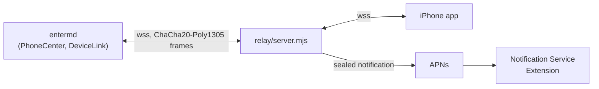
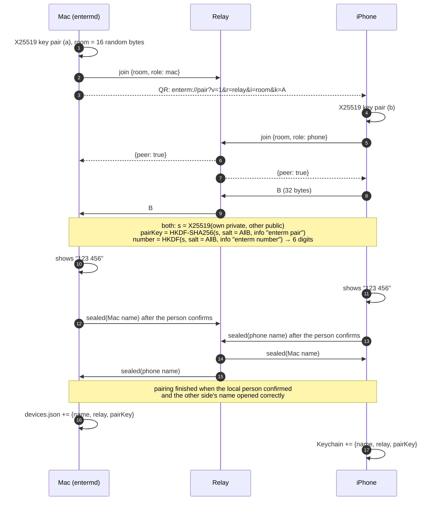

# iPhone Companion

The iPhone app lets you follow and steer the sessions running on your Mac: watch terminals, read Claude Code and Codex sessions as a conversation, answer approval requests from the lock screen, start sessions and control races. The sessions keep running on the Mac; the phone only shows them and sends input.

The phone is optional. Nothing related to it runs on the Mac until a phone has been paired.

<!-- TODO: verify — link the iPhone app (App Store or TestFlight) once it is public -->

**On this page**

- [How it connects](#how-it-connects)
- [Pairing](#pairing)
- [Encryption on every connection](#encryption-on-every-connection)
- [What the relay can and cannot see](#what-the-relay-can-and-cannot-see)
- [Notifications](#notifications)
- [Approvals and Face ID](#approvals-and-face-id)
- [App lock](#app-lock)
- [Live Activity](#live-activity)
- [What the phone can do on the Mac](#what-the-phone-can-do-on-the-mac)
- [Data stored on each side](#data-stored-on-each-side)
- [Unpairing](#unpairing)
- [Self-hosting the relay](#self-hosting-the-relay)

## How it connects



The Mac side lives in the session service, not the window (`Sources/entermd/PhoneCenter.swift`), so the phone keeps working while the Enterm window is closed. Each paired phone becomes an ordinary client of the service through a local socket pair: it receives the same session list and terminal output the window does, limited to an allowlist of operations ([below](#what-the-phone-can-do-on-the-mac)).

Mac and phone never connect to each other directly. Both open a WebSocket to a **relay** and join the same room; the relay forwards binary frames between the two members of a room. The default relay is `wss://enterm.enmeraapps.com`, operated by Enmera; you can change it in **Settings → Phone** (the **Relay Service** row) or run your own ([Self-hosting](#self-hosting-the-relay)).

If the connection drops, each side reconnects after 1 second, doubling the delay up to 60 seconds; returning the phone app to the foreground retries at once. When the Mac is about to sleep, the service tells the phone, which then shows the Mac as sleeping rather than unreachable.

## Pairing

1. On the Mac, open **Pair Phone** (the phone icon in the top bar) and press **Pair Phone**. The service creates a fresh X25519 key pair and a random 16-byte room ID, and shows a QR code. The code is valid for 5 minutes.
2. On the iPhone, tap **Scan Code** and scan it. If the camera is unavailable, **Copy Code** on the Mac copies the same link to send to the phone.
3. Both screens show the same six-digit number, written as two groups of three. Compare them.
4. Press **Numbers Match** on the Mac and **Yes, They Match** on the phone. If the numbers differ, cancel: someone may be in the middle.

The QR code is a link of the form:

```
enterm://pair?v=1&r=<relay URL>&i=<room id, 32 hex>&k=<Mac public key, base64url>
```

The phone accepts it only if the version is `1`, the key is 32 bytes, the room is 32–64 lowercase hex characters and the relay is a `ws` or `wss` URL.



The relay sees both public keys but cannot compute the shared secret. A relay that substituted its own keys would end up with a different secret on each side, and therefore a different number on each screen; that is what the comparison catches. The device names are exchanged only under the new key.

After pairing, the room for all later connections is derived from the key (`HKDF(pairKey, info "enterm room")`, first 16 bytes as hex), so it reveals nothing about the key and is the same every time. The phone stores one Mac; pairing another replaces it. A Mac can have several phones.

## Encryption on every connection

The pairing key is never used directly to encrypt traffic (`TunnelLink`, `TunnelCipher` in `Sources/EntermCore/RelayLink.swift` and `Tunnel.swift`):

1. When both sides are in the room, each sends 32 fresh random bytes (a salt).
2. Each side derives two keys with HKDF-SHA256 over the pairing key, salt = Mac salt ‖ phone salt: one for `mac to phone`, one for `phone to mac`.
3. Every frame is sealed with ChaCha20-Poly1305. The nonce is a counter per direction that never repeats within a connection.

A frame that fails to open (wrong key, replayed, reordered or dropped by the relay) ends the connection, and the link reconnects with new salts. Every connection therefore has fresh keys.

## What the relay can and cannot see

| The relay can see | The relay cannot see |
| --- | --- |
| The IP addresses of the Mac and the phone | Terminal output, keystrokes, session names, folders, approval texts, diffs: everything inside the frames |
| The room ID (derived from the key, not reversible) and each member's role (`mac` / `phone`) | The pairing key or the per-connection keys |
| When frames are sent and how large they are | The device names (exchanged sealed) |
| The X25519 public keys during pairing and the random salts on each connection | The contents of a notification |
| For a notification: the phone's APNs device token, the sealed payload, and whether it is an `approval` or an `event` | |

The relay keeps rooms and a per-room push counter in memory only. It writes nothing to disk and logs one line at start (`relay/server.mjs`).

## Notifications

The service sends a notification to paired phones when a session's status changes to:

| Status | Title | Body |
| --- | --- | --- |
| Needs Approval | `◆ <session>` | The approval summary (for example the command) |
| Limit Reached | `■ <session>` | "Limit Reached" |
| Failed | `✕ <session>` | "Error" |

It also forwards `enterm notify "<text>"` (see [faq.md](faq.md#can-my-own-scripts-send-a-notification)) and a few notices from the window (for example a Codex limit warning).

How a notification travels:

1. The Mac encodes the notice (kind, title, body, session number, approval ID) and seals it with ChaCha20-Poly1305 under a key derived from the pairing key (`HKDF(pairKey, info "enterm notification")`).
2. It sends `{push: {token, sealed, kind}}` to the relay over the WebSocket. The phone gave the Mac its APNs token through the encrypted link.
3. The relay signs an APNs provider token with its own key and posts to Apple. Apple receives only the generic alert (title `Enterm`, body "Yeni Bir Bildirim Var", "There is a new notification"), the category (`APPROVAL` or `EVENT`), `mutable-content: 1`, and the sealed blob in `enc`.
4. On the phone, the Notification Service Extension (`enterm-ios/EntermNotify`) reads the pairing key from the shared Keychain, opens `enc`, and replaces the title and body with the real text, translated into the phone's language.

Requirements and limits:

- The phone must allow notifications (asked after pairing, or **Settings → Allow Notifications** in the phone app).
- The relay must be configured with an APNs key (`APNS_*` variables). A relay without one still carries the live connection but sends no notifications.
- The relay accepts at most 30 push requests per room per minute.
- Notifications on the **Mac** itself are separate (**Settings → Notifications → System Notifications**). macOS refuses notifications to ad-hoc signed apps, so a build from source shows them only when signed with a Developer ID ([troubleshooting](troubleshooting.md#mac-notifications-do-not-appear)).

## Approvals and Face ID

An approval request shows on the phone's Approvals tab, inside the session, and as a notification with **Allow**, **Deny** and **See Details** actions.

- **Allow** asks for Face ID, Touch ID or the passcode first (`LAContext`, `deviceOwnerAuthentication`) while **Face ID for Approvals** is on (the default). The notification action also requires the device to be unlocked.
- **Deny** never asks.
- If the Mac is not reachable at that moment, the decision is queued and sent when the link is back. A decision only counts if the request is still open on the Mac: the hook waits up to 590 seconds (45 seconds for One-Click Approval on the Open card), after which the program's own prompt is on the Mac's screen.
- A phone with no passcode set has nothing to ask, and the check passes.

The phone also asks for authentication before actions that widen what an agent can do: starting an agent (not a plain terminal), widening a permission on a card (narrowing never asks), installing a program, adding a link, switching accounts, building a team, starting a queued session, resuming. Turning **Face ID for Approvals** or **App Lock** off asks too; turning them on does not.

## App lock

**App Lock** is on by default. The app locks at launch and after more than 60 seconds in the background, and shows "App Locked" until you authenticate, because whoever holds the unlocked phone could otherwise run commands on the Mac through a terminal.

## Live Activity

While at least one agent on the Mac is working or waiting for approval, the app keeps one Live Activity on the Lock Screen and in the Dynamic Island (`enterm-ios/Enterm/LiveStatus.swift`, `EntermWidgets`): the Mac's name, how many agents are working, how many are waiting, and the session that needs you (or the one working longest) with its status. It ends when nothing is working or waiting.

iOS lets the app update it only while the app is running. Once the app is suspended, the Live Activity stays as it was (marked stale after 15 minutes) until the app returns. Updates pushed from the Mac through APNs while the phone sleeps are not implemented yet.

## What the phone can do on the Mac

Directly in the service, a phone may only send these operations (`PhoneCenter.allowedOperations`): `hello`, `create`, `attach`, `detach`, `resize`, `kill`, `remove`, `rename`, `decide`, `list`, `tail`, `stop`, `setPriority`, `chat`, plus terminal input. A `resize` from a phone is ignored: the phone draws the Mac window's grid and scrolls over it, so looking from the phone never changes the Mac's terminal size. Hook events, approval requests, shutdown and the rest stay local.

Everything that lives in the window (accounts, Git changes and diffs, links, permission cards, the browser, the team, the power limit, races, starting programs with the same PATH, account and queue rules as the Mac) goes as an `appCall` to the window (`Sources/EntermApp/PhoneBridge.swift`). If the window is closed, the service opens the app in the background without bringing it forward, and waits up to 8 seconds for it. A call that gets no answer within 15 seconds shows "Computer Didn't Respond".

Diffs sent to the phone are cut at 200,000 characters; the browser picture is a JPEG snapshot 480 points wide, taken only when the phone asks.

## Data stored on each side

| Where | What | How |
| --- | --- | --- |
| Mac, `~/Library/Application Support/Enterm/devices.json` | Each phone's name, relay URL, pairing key, pairing date, last seen time and APNs token | File mode `0600` |
| iPhone Keychain (service `tr.com.enmera.enterm`, account `paired-mac`) | The Mac's name, relay URL and pairing key | `AfterFirstUnlockThisDeviceOnly`, shared with the notification extension through a Keychain access group; not synced to other devices |
| iPhone caches, `last-sessions.json` | The last known session list, so the app has something to show before it connects | Removed when you unpair |
| iPhone `UserDefaults` | Theme, language, Face ID for Approvals, App Lock | |
| Relay | Nothing persistent | In memory: rooms and push timestamps |

On the Mac the pairing keys are in a file, not the Keychain. The maintainer notes explain why: an unsigned service would show a Keychain password prompt on every access. Moving the keys into the Keychain in signed builds is planned ([MAINTAINERS.md](MAINTAINERS.md#telefon-aktarımı-açılmadan-önce), Turkish).

## Unpairing

- **On the Mac:** **Pair Phone** page → **Remove** next to the device. The service tells the phone it was unpaired, closes the link and deletes the device from `devices.json`.
- **On the phone:** **Settings → Remove Computer**. The pairing key and the cached session list are deleted. Sessions on the Mac keep running.

## Self-hosting the relay

The relay is one file, `relay/server.mjs`, with no dependencies beyond Node's standard library. `relay/README.md` and `relay/DEPLOY.md` (both Turkish) describe Enmera's own deployment.

Run it locally:

```bash
node relay/server.mjs
```

Run its tests:

```bash
node --test relay/
```

Configuration is through environment variables:

| Variable | Meaning |
| --- | --- |
| `PORT`, `HOST` | Listen address. Default `127.0.0.1:8787` |
| `RELAY_TLS_CERT`, `RELAY_TLS_KEY` | Serve TLS directly. Without them, put a TLS-terminating proxy in front |
| `APNS_KEY_PATH`, `APNS_KEY_ID`, `APNS_TEAM_ID`, `APNS_TOPIC` | APNs provider key (`.p8`), key ID, team ID and the app's bundle ID. The key stays on the server |
| `APNS_HOST` | APNs endpoint. Default `https://api.push.apple.com`; `https://api.sandbox.push.apple.com` for development builds |

Behaviour worth knowing when you operate it:

- WebSocket only, on any path. `GET /health` answers `ok`; every other HTTP request gets `404`.
- A room holds at most one Mac and one phone. A newcomer with the same role replaces the old connection (close code `4000`); a third member is refused (`4001`). Room IDs must be 32–64 lowercase hex characters.
- Messages larger than 1 MiB close the connection (`1009`). Clients must mask their frames.
- The relay pings every 30 seconds and drops a peer that did not answer the previous ping. This also keeps idle connections alive behind proxies such as Cloudflare.
- Behind nginx, forward the upgrade headers and raise `proxy_read_timeout` (Enmera's configuration in `DEPLOY.md` uses 3600 s).
- `relay/install.sh` installs it as a systemd unit `enterm-relay` running under `DynamicUser` with `ProtectSystem=strict`, listening on `127.0.0.1:8787`. It looks for Node at Plesk's path first, then on `PATH`.

Notifications need an APNs key for the app's bundle ID (`tr.com.enmera.enterm.ios`). A relay with someone else's key cannot deliver to the App Store build of the app, so a self-hosted relay without Enmera's key gives you the live connection but no push notifications, unless you also build the iPhone app under your own team and bundle ID. <!-- TODO: verify — confirm this is the intended guidance for self-hosters -->

To use your relay, enter its `wss://` URL in **Settings → Phone** on the Mac before pairing. The relay URL is part of the pairing, so phones paired through another relay have to be paired again.
