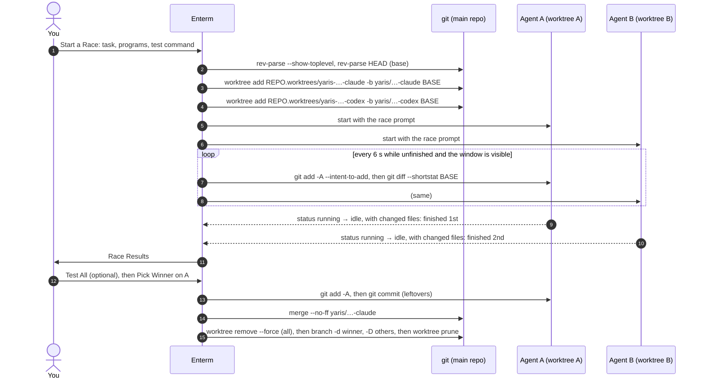

# Race

A race gives the same task to two or three agents at once, each in its own git worktree branched from the same commit, so you can compare what each one did and merge the one you like. Your main folder is not touched until you pick a winner.

The record and the rules live in `Sources/EntermCore/Race.swift` (no git, no UI, unit-tested in `Tests/EntermCoreTests/RaceTests.swift`); the app side that runs git, opens the boxes and draws the lanes is `Sources/EntermApp/Race.swift`.

**On this page**

- [Overview](#overview)
- [Starting a race](#starting-a-race)
- [Branches and folders](#branches-and-folders)
- [The prompt](#the-prompt)
- [While the race runs](#while-the-race-runs)
- [How a finish is detected](#how-a-finish-is-detected)
- [Results and tests](#results-and-tests)
- [Picking a winner (merge)](#picking-a-winner-merge)
- [Dropping a race](#dropping-a-race)
- [From the phone](#from-the-phone)
- [Files written](#files-written)
- [Limitations](#limitations)

## Overview



## Starting a race

Open **Start a Race** from the command palette or the action menu. The setup page asks for:

| Field | Notes |
| --- | --- |
| **Task** | Required. The same text goes to every agent. |
| **Racers** | At least two of **Claude Code**, **Codex** and **Gemini** (`RaceCenter.programs`). A program that is not installed is greyed out and cannot be chosen; Claude Code and Codex are preselected. |
| **Test Command** | Prefilled from the folder's files ([detection](#test-command-detection)); leave it empty to skip tests. |
| Folder | The folder of the focused box, or your home folder if none is focused. |

`RaceCenter.start` then:

1. Runs `git rev-parse --show-toplevel` in the folder. Not a repository: "This folder is not a git repository."
2. Runs `git rev-parse HEAD` at the repository root. No commit yet: "The repository has no commits yet. A race starts from a commit." That commit is the race's **base**.
3. Lists existing branches, picks a unique branch name per program, and runs `git worktree add <folder> -b <branch> <base>` for each. If any of them fails, the worktrees already made are removed again and the error is shown ("Couldn't open worktree: …").
4. Saves the race to `races.json`, then starts each program in its worktree with the race prompt.
5. Puts the racers in a group and a project tab of their own (named after the task), side by side, and fits them in view once all boxes are open.

Starting the agents goes through the normal launcher, so the [power limit](architecture.md#resource-use-and-the-motion-rule) applies: a racer may wait in the queue. Each racer's clock starts when its box opens, not when the race was created.

## Branches and folders

**Branch:** `yaris/<slug>-<program>`. *Yarış* is Turkish for race; like other identifiers in Enterm it is kept in Turkish.

- `<slug>` is made from the task (`RacePlan.slug`): Turkish dotless `ı`/`İ` are spelled `i`/`I`, the text is transliterated to Latin and stripped of accents, lowercased, every run of characters other than ASCII letters and digits becomes one `-`, and it is cut at 28 characters with trailing dashes removed. A task with no usable characters gives `gorev` ("task").
- `<program>` is the program's identifier: `claude`, `codex` or `gemini`.
- If the branch already exists in the repository, `-2`, `-3`, … is appended.

Example: the task "Fix the coupon refund" with Claude Code and Codex gives `yaris/fix-the-coupon-refund-claude` and `yaris/fix-the-coupon-refund-codex`.

**Folder:** next to the repository, like every worktree Enterm opens (`RacePlan.folder`):

```
<parent of repo>/<repo name>.worktrees/<branch with "/" replaced by "-">
```

For a repository at `~/code/shop` this is `~/code/shop.worktrees/yaris-fix-the-coupon-refund-claude`.

## The prompt

Every agent receives exactly the same text (`RacePlan.prompt`), as its first message on the command line:

```
<task>

This folder is a git worktree made for you alone; other agents are doing the same task in their own folders. Work only here. When you are done, commit your work on this branch with a short message and stop.
```

Claude Code and Codex get it as their positional prompt argument; Gemini gets it with `-i`, which starts an interactive session with that first prompt.

## While the race runs

Each racing box shows a lane under its terminal: elapsed time, files changed, lines added and removed (`+N −M`), and a runner on a track toward a flag. Click the lane to open the results.

- **Measuring.** Every 6 seconds (only while some racer has not finished and the Enterm window is visible), and once more when a racer goes quiet, Enterm runs in that racer's worktree:

  ```bash
  git add -A --intent-to-add     # new files count too: marked, not staged
  git diff --shortstat <base>
  ```

  and parses files, insertions and deletions. The intent-to-add step changes the worktree's index; it does not touch your main folder.
- **Progress.** The runner's position is the racer's changed lines (insertions + deletions) relative to the racer with the most, scaled to stay short of the flag (4% to 90% of the track). A finished racer is at the flag. Lines are a sign of life, not of quality; the results page says so too.
- **Medals.** When a racer finishes, its place (1, 2, 3) pops in where the runner stopped, in gold, silver or bronze, and the box border flashes once (only when [motion](architecture.md#resource-use-and-the-motion-rule) is allowed).
- **Transcript.** While measuring, Enterm saves the racer's transcript path into the race, so the [replay](timeline.md) still works after the boxes are gone.

## How a finish is detected

A racer has crossed the line the first time all of these are true (`RaceCenter.watch`, `measure`):

1. Its session was seen in status **Running** at least once since the race started.
2. Its session is now **Idle**.
3. The measurement taken at that moment shows **at least one changed file** against the base.

Going quiet with no changes is treated as a question to you, not a finish, and the racer stays unfinished. Finishing order is the order of these moments; racers still working are listed after, in the order they started. When every racer has finished, Enterm shows "Race Over · Results Ready", posts a Mac notification if the window is in the background, and opens the results page unless you are in another page or dialog.

After a racer has finished, its numbers are no longer updated. If it keeps working (for example you ask it for more), the lane keeps the numbers from its finish; the merge still takes everything in its worktree ([below](#picking-a-winner-merge)).

## Results and tests

The **Race Results** page lists the racers in finishing order with place, time, files and `+/−` lines, and offers:

| Action | Effect |
| --- | --- |
| **View Diff** | Focuses the racer's box and opens the Changes page for its worktree |
| **Test** / **Test All** | Runs the race's test command in one or every worktree |
| **Pick Winner** | Merges that racer ([below](#picking-a-winner-merge)) |
| **Replay the Race** | Opens the [timeline](timeline.md) with one lane per racer |
| **Drop Race** | Ends the race without a winner ([below](#dropping-a-race)) |

**Running tests.** Each test runs in the background as `$SHELL -lc 'cd <worktree> && <command>'`, so it sees the same `PATH` as your terminal. Output is discarded; the result is **Tests Passed** for exit status 0 and **Tests Failed** for anything else, including a command that could not start. A test still running after 10 minutes is killed and counts as failed. Tests of different racers run on the same background queue, one after another.

### Test command detection

`RacePlan.testCommand` looks at the files in the race folder, in this order; the first match wins:

| File present | Test command |
| --- | --- |
| `Package.swift` | `swift test` |
| `Cargo.toml` | `cargo test` |
| `go.mod` | `go test ./...` |
| `package.json` + `pnpm-lock.yaml` | `pnpm test` |
| `package.json` + `yarn.lock` | `yarn test` |
| `package.json` + `bun.lockb` or `bun.lock` | `bun test` |
| `package.json` | `npm test` |
| `pyproject.toml`, `pytest.ini` or `setup.py` | `python3 -m pytest` |
| `Gemfile` | `bundle exec rake test` |
| `Makefile` | `make test` |
| none of these | empty: no tests unless you type a command |

Only the top level of the folder is looked at.

## Picking a winner (merge)

**Pick Winner** asks for confirmation, then `RaceCenter.merge`:

1. **Checks the main folder.** `git status --porcelain --untracked-files=no` at the repository root must be empty. If tracked files have uncommitted changes, the merge is refused: "The main folder has uncommitted changes. Commit or stash them first." Untracked files do not block it.
2. **Commits leftovers in the winner's worktree.** `git add -A`; if anything is staged, `git commit -m "<task> (<program>)"`. This catches work the agent did not commit itself.
3. **Merges** in the repository root, into whatever branch is checked out there:

   ```bash
   git merge --no-ff -m "Yarış: <task> · Kazanan <program>" yaris/<slug>-<program>
   ```

   The merge commit message is in Turkish ("Race: … · Winner …"). If the merge fails (for example on a conflict), Enterm runs `git merge --abort` and shows "Couldn't merge: …" with git's output; the race stays open and nothing is removed.
4. **Cleans up.** The race is marked closed with its winner. The boxes close one after another, losers first. Then, for every racer, `git worktree remove --force <folder>` and `git branch -d` for the winner (safe, it is merged) or `git branch -D` for the others, and finally `git worktree prune`. The race's group is removed and Enterm returns to the project tab you started from.

`--force` on worktree removal means uncommitted work in a **losing** worktree is discarded. Look at the diffs before you pick.

## Dropping a race

**Drop Race** asks for confirmation, then closes every racer's box, removes every worktree with `--force`, deletes every race branch with `-D`, prunes worktrees, and marks the race closed without a winner. Your main folder is not changed.

## From the phone

The iPhone app's **Races** screen (`enterm-ios/Enterm/RaceScreen.swift`) lists open races first, then recently finished ones, up to eight in total, with standings, times and line counts. From there you can **Test All**, pick a winner (with a confirmation) and drop a race. These go through the window's `raceTest`, `raceMerge` and `raceDrop` calls (`PhoneBridge.swift`), so the rules above, including the dirty-main-folder check, apply unchanged; a refused merge shows the same message on the phone. See [phone.md](phone.md).

## Files written

| Location | What |
| --- | --- |
| `~/Library/Application Support/Enterm/races.json` | Every race, open and closed: task, repository root, base commit, test command, and per racer the program, branch, folder, session ID, start and finish times, diff stats, test result and transcript path; plus the winner and whether it is closed. Closed races stay as history (they feed the replay and the phone's list). |
| `<repo>.worktrees/<branch>/` | One worktree per racer, removed when the race ends |
| `yaris/<slug>-<program>` branches | One per racer, deleted when the race ends (the winner's after it is merged) |
| Commits | Leftover commit in the winner's branch, and the `--no-ff` merge commit in the main folder's current branch |

## Limitations

- **Programs.** Only Claude Code, Codex and Gemini can race: the programs that take a first instruction on the command line and stay open to talk.
- **Local only.** A race runs on a repository on this Mac; remote (SSH) projects are not supported.
- **Finish detection is a heuristic.** It relies on the session status:
  - Claude Code and Codex report status through hooks, so "idle" means the turn ended.
  - Codex needs its hooks trusted ([troubleshooting](troubleshooting.md#codex-status-needs-your-approval)). Without them Enterm only learns the end of a turn (through Codex's `notify`) and marks Codex running only when you press Enter in it. A race prompt arrives on the command line, not through Enter, so an untrusted Codex racer may never be seen as running and its finish may not be detected.
  - Gemini's status comes partly from its output: three quiet seconds mark it idle. A Gemini racer that pauses for a few seconds after changing a file can be counted as finished early.
  - An agent that stops to ask you something without changing a file is not finished; one that asks after changing files may be.
  - An agent that finishes but is waiting for approval is not idle, so it has not finished.
- **Stats freeze at the finish**, as described above.
- **Lines are not quality.** The progress bar and stats count lines, nothing more. Use the diffs and tests.
- **Test results are pass/fail only**; the output is not kept. Run the command in the worktree's box to see it.
- **Merging does not resolve conflicts.** A conflicting merge is aborted; resolve it yourself in the main folder (the race branches remain until you drop the race).
- **Commit messages are Turkish** for the merge commit.
